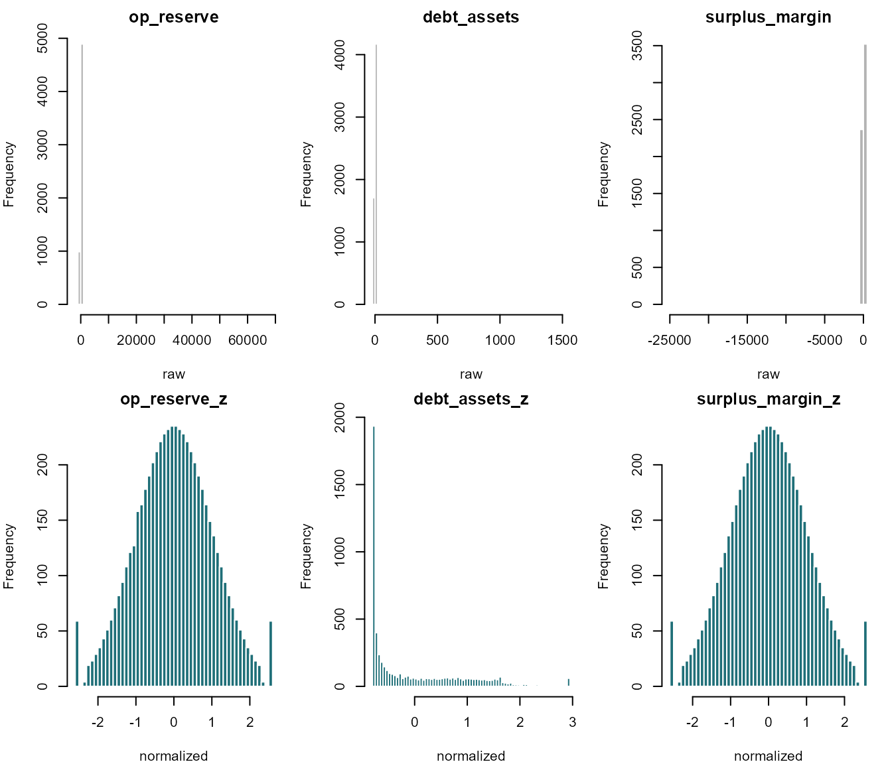
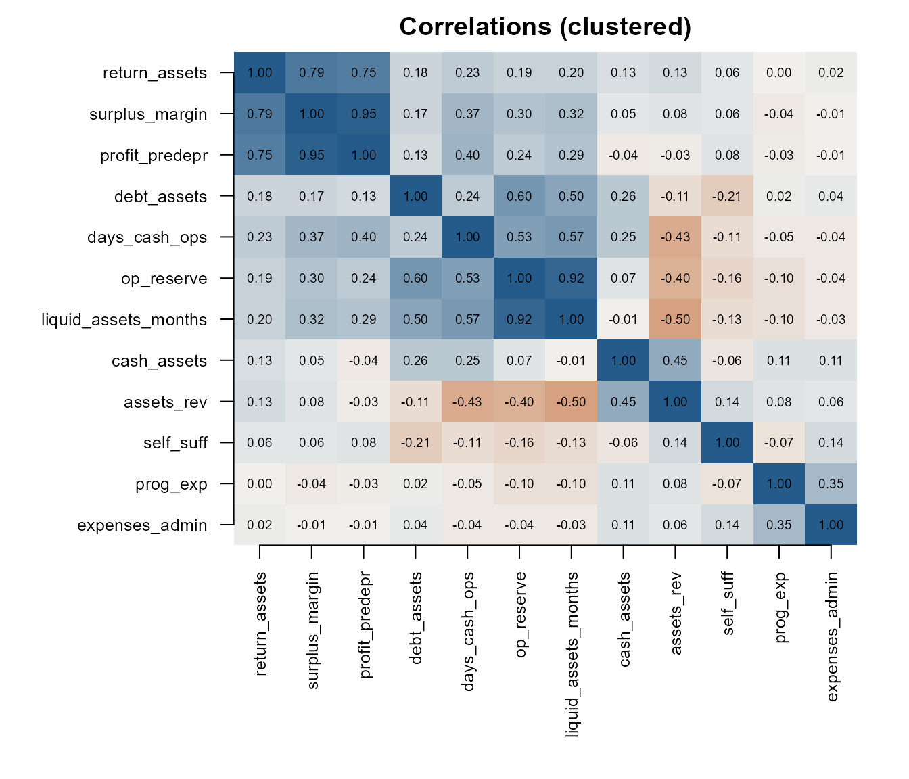
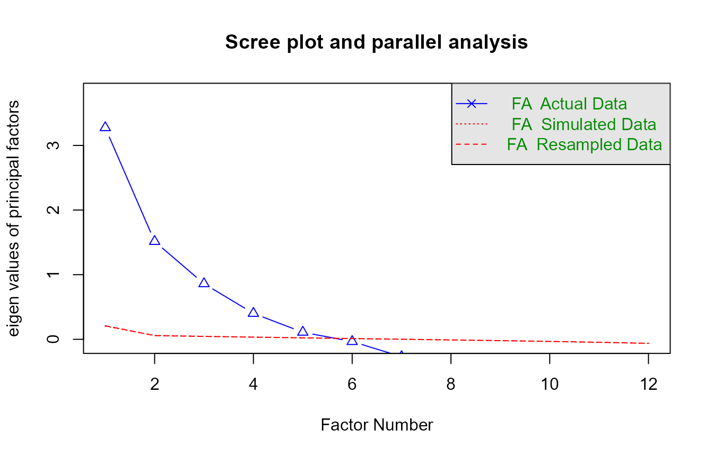
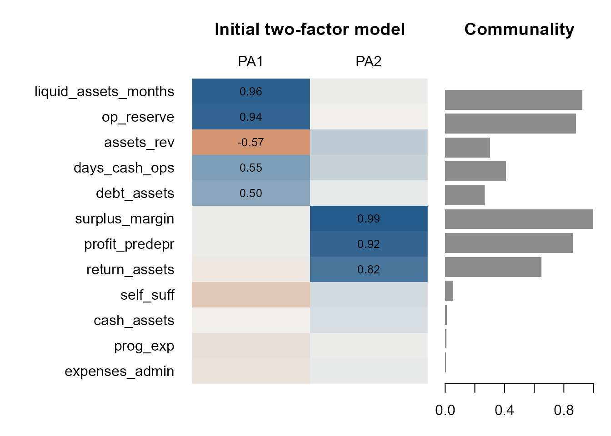
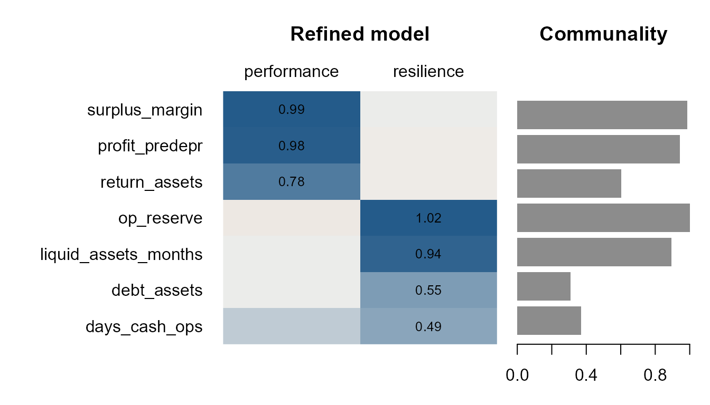

# Building a fiscal health index: a measurement approach

Nobody observes *fiscal health* directly. What we observe are dozens of
accounting ratios, each a noisy, partial reflection of an organization’s
financial condition. This vignette treats fiscal health the way a
psychometrician treats an unobserved trait: as a **latent construct**
that we measure by combining indicators. It follows the factor-analysis
recipe in [Measurement with factor
analysis](https://lecy.github.io/econometrics/lectures2/measurement-factor-analysis.html),
applied to 2023 Form 990 filers in `dat10k`.

For the software pipeline that turns a reviewed model into reusable
scores, see
[`vignette("fiscal-health-workflow")`](https://nonprofit-open-data-collective.github.io/fiscal/articles/fiscal-health-workflow.md).
This vignette is about the *measurement decisions* that come before it.

## What the model assumes

Factor analysis assumes that each standardized indicator is a weighted
combination of a few shared latent factors plus a part unique to that
indicator:

``` math
X = \Lambda F + \epsilon
```

- $`X`$: the observed indicators (standardized fiscal ratios)
- $`F`$: the latent factors, the dimensions of fiscal health we want to
  recover
- $`\Lambda`$: the **loadings**, how strongly each indicator reflects
  each factor
- $`\epsilon`$: the **uniqueness**, variance the factors do not explain,
  including measurement error and ratio-specific quirks

Three outputs matter most. **Loadings** tell us what each factor means.
**Communality** ($`h^2`$) is the share of an indicator’s variance
explained by the factors. **Factor scores** are each organization’s
estimated position on each dimension, the building blocks of an index.

> **A caveat specific to financial ratios.** The model is *reflective*:
> it assumes the latent condition causes the indicators to move
> together. Accounting ratios also move together *mechanically*, because
> they share numerators and denominators (equity is literally one minus
> the debt ratio). Part of the measurement work below is separating
> substantive covariation from arithmetic.

## 1. Setup

``` r

library(fiscal)
library(psych)        # KMO(), cortest.bartlett(), fa.parallel(), fa(), alpha()
library(GPArotation)  # oblique rotation used by psych::fa()
```

## 2. Conceptualize the construct and choose candidate indicators

Measurement starts with theory, not data. We define **fiscal health** as
an organization’s capacity to keep delivering its mission through
ordinary shocks. The nonprofit finance literature (Tuckman & Chang 1991;
Greenlee & Trussel 2000; Bowman 2011) suggests at least two facets:

- **Resilience (stocks):** cash and reserves relative to spending, and
  how much of the balance sheet is financed by debt.
- **Operating performance (flows):** whether revenues cover expenses
  year to year.

Content validity also tells us what fiscal health is *not*. The share of
spending on programs or administration, and how much revenue comes from
fees, describe a **business model** or an **efficiency** norm. We
include three such indicators on purpose: if the model is measuring
fiscal condition, they should *not* load on its factors (a check on
discriminant validity).

[`fiscal_metrics()`](https://nonprofit-open-data-collective.github.io/fiscal/reference/fiscal_metrics.md)
is the data dictionary. It records each metric’s category and the
direction in which it is healthier.

``` r

reg <- fiscal_metrics()

candidates <- c(
  # resilience
  "days_cash_ops", "op_reserve", "liquid_assets_months", "cash_assets", "debt_assets",
  # operating performance
  "surplus_margin", "profit_predepr", "return_assets",
  # business model / efficiency (discriminant checks)
  "self_suff", "prog_exp", "expenses_admin",
  # asset intensity
  "assets_rev"
)

dd <- reg[match(candidates, reg$metric), c("metric", "function_name", "category", "direction")]
dd$domain <- c(rep("resilience", 5), rep("performance", 3),
               rep("business model", 3), "asset intensity")
knitr::kable(dd, row.names = FALSE)
```

| metric | function_name | category | direction | domain |
|:---|:---|:---|:---|:---|
| days_cash_ops | get_days_cash_operations | liquidity | higher | resilience |
| op_reserve | get_operating_reserve_ratio | asset_structure | higher | resilience |
| liquid_assets_months | get_liquid_assets_months | liquidity | higher | resilience |
| cash_assets | get_cash_assets_ratio | liquidity | higher | resilience |
| debt_assets | get_debt_assets_ratio | solvency | lower | resilience |
| surplus_margin | get_surplus_margin_ratio | performance | higher | performance |
| profit_predepr | get_profit_margin_predepr | performance | higher | performance |
| return_assets | get_return_assets_ratio | performance | higher | performance |
| self_suff | get_self_sufficiency_ratio | performance | higher | business model |
| prog_exp | get_program_expenses_ratio | expense_structure | higher | business model |
| expenses_admin | get_expenses_admin_ratio | expense_structure | lower | business model |
| assets_rev | get_assets_revenue_ratio | asset_structure | lower | asset intensity |

Many metrics in the registry were screened out before this point, and
each screen is itself a measurement decision:

- **Composition measures** (revenue mix, expense mix, asset mix) have
  direction `"context"`: more is not clearly better or worse.
- **Dollar levels** (`cash_on_hand`) measure size, not condition.
- **Structural missingness:** current, quick, and cash-liquidity ratios
  are undefined when current liabilities are zero, which is true of a
  large share of filers.
- **Algebraic identities:** `equity` is `1 - debt_assets`,
  `months_cash_ops` is a rescaled `days_cash_ops`, and `overhead` is
  `1 - prog_exp`. Identities make the correlation matrix singular and
  inflate a construct’s apparent weight.
- **Signed denominators:** ratios over net assets (`debt_equity`,
  `return_netassets`, `netassets_growth`) flip sign when net assets are
  negative, so they are not monotone in health.

### The analysis sample

Most indicators require full Form 990 detail (Part IX functional
expenses and Part X balance sheet), so the sample is full-990 filers
with positive revenue, expenses, and assets.

``` r

d <- dat10k[dat10k$RETURN_TYPE == "990" &
            dat10k$F9_08_REV_TOT_TOT  > 0 & !is.na(dat10k$F9_08_REV_TOT_TOT) &
            dat10k$F9_09_EXP_TOT_TOT  > 0 & !is.na(dat10k$F9_09_EXP_TOT_TOT) &
            dat10k$F9_10_ASSET_TOT_EOY > 0 & !is.na(dat10k$F9_10_ASSET_TOT_EOY), ]

scored <- compute_all(d, metrics = c("ratio", "z"), append_to_df = FALSE,
                      verbose = FALSE)
nrow(scored)
#> [1] 5892
```

## 3. Standardize and orient the indicators

### Why the `_z` columns

Factor analysis works on the correlation matrix, the covariance matrix
of z-scores. Plain z-scores of fiscal ratios, though, are dominated by a
handful of organizations with near-zero denominators. Every `get_*()`
function therefore also returns a `_z` column: the ratio is winsorized,
passed through a distribution-aware transformation, and standardized
([`vignette("normalization")`](https://nonprofit-open-data-collective.github.io/fiscal/articles/normalization.md)).
The transformation is monotone, so it preserves the rank ordering of
organizations.

Compare three raw ratios with their `_z` versions:

``` r

show <- c("op_reserve", "debt_assets", "surplus_margin")
op <- par(mfrow = c(2, 3), mar = c(4, 4, 2, 1))
for (m in show) hist(scored[[m]], breaks = 60, main = m, xlab = "raw", col = "grey70", border = "white")
for (m in show) hist(scored[[paste0(m, "_z")]], breaks = 60, main = paste0(m, "_z"),
                     xlab = "normalized", col = "#1f6f78", border = "white")
```



``` r

par(op)
```

The raw histograms are nearly empty: a few extreme values stretch each
axis so far that almost every organization lands in a single bar. The
normalized versions use the whole scale. Some shapes are not bell
curves, and should not be: 28% of filers report no liabilities at all,
so `debt_assets_z` has a single spike for that tied group, placed at its
middle rank, followed by the rest of the distribution.

A useful check that the transformation has not distorted the
relationships: Pearson correlations of the `_z` columns should track the
rank (Spearman) correlations of the raw ratios.

``` r

raw <- scored[candidates]
raw[] <- lapply(raw, function(x) { x[!is.finite(x)] <- NA; x })
Z   <- scored[paste0(candidates, "_z")]
names(Z) <- candidates

r_spearman <- cor(raw, method = "spearman", use = "pairwise.complete.obs")
r_pearson  <- cor(Z, use = "pairwise.complete.obs")
low <- lower.tri(r_pearson)
round(cor(r_spearman[low], r_pearson[low]), 3)   # agreement across all pairs
#> [1] 0.993
```

### Orient every indicator so that higher is healthier

Loadings are easiest to read when every indicator points the same way.
We flip the sign of indicators whose registry direction is `"lower"`.

``` r

flip <- dd$metric[dd$direction == "lower"]
flip
#> [1] "debt_assets"    "expenses_admin" "assets_rev"
X <- Z
X[flip] <- lapply(X[flip], function(x) -x)
used <- complete.cases(X)   # keep track of the rows that enter the model
X <- X[used, ]
dim(X)
#> [1] 5890   12
```

## 4. Is the data factorable?

Before fitting anything, look at the correlation structure. Ordering the
indicators by hierarchical clustering places blocks of correlated
indicators next to each other; those blocks are the factors we expect to
find.

``` r

R <- cor(X)
ord <- hclust(as.dist(1 - abs(R)))$order
Ro <- R[ord, ord]

pal <- colorRampPalette(c("#bd5416", "#f0efec", "#245b8a"))(101)
op <- par(mar = c(9, 9, 2, 2))
image(1:ncol(Ro), 1:nrow(Ro), t(Ro)[, nrow(Ro):1], zlim = c(-1, 1), col = pal,
      axes = FALSE, xlab = "", ylab = "", main = "Correlations (clustered)")
axis(1, at = 1:ncol(Ro), labels = colnames(Ro), las = 2, cex.axis = 0.8)
axis(2, at = nrow(Ro):1, labels = rownames(Ro), las = 1, cex.axis = 0.8)
text(rep(1:ncol(Ro), each = nrow(Ro)), rep(nrow(Ro):1, ncol(Ro)),
     sprintf("%.2f", Ro), cex = 0.6)
```



``` r

par(op)
```

Two standard checks:

- **Kaiser-Meyer-Olkin (KMO)** measures how much of each correlation is
  shared with the other indicators. Above 0.70 is good; indicators below
  0.50 share little with the set and are candidates for removal.
- **Bartlett’s test** asks whether the correlation matrix differs from
  an identity matrix. A small p-value means there is shared variance to
  factor.

``` r

kmo  <- KMO(R)
bart <- cortest.bartlett(R, n = nrow(X))

round(kmo$MSA, 2)
#> [1] 0.64
sort(round(kmo$MSAi, 2))
#>          cash_assets           assets_rev       expenses_admin 
#>                 0.32                 0.48                 0.51 
#>             prog_exp       profit_predepr        days_cash_ops 
#>                 0.52                 0.64                 0.65 
#>           op_reserve       surplus_margin liquid_assets_months 
#>                 0.65                 0.65                 0.71 
#>            self_suff          debt_assets        return_assets 
#>                 0.72                 0.73                 0.92
bart$p.value
#> [1] 0
```

The overall KMO of 0.64 is mediocre but workable, and Bartlett’s test
rejects an identity matrix. The item-level values already flag
`cash_assets` and `assets_rev` as sharing little with the other
indicators.

## 5. How many factors?

A **scree plot** shows the eigenvalues in descending order; look for the
elbow. **Parallel analysis** compares them with eigenvalues from random
data of the same size and keeps the factors that beat the random
benchmark.

``` r

set.seed(2023)
pa <- fa.parallel(X, fm = "pa", fa = "fa", n.iter = 50,
                  main = "Scree plot and parallel analysis")
```



    #> Parallel analysis suggests that the number of factors =  5  and the number of components =  NA
    pa$nfact
    #> [1] 5
    round(pa$fa.values, 2)
    #>  [1]  3.27  1.51  0.86  0.40  0.11 -0.03 -0.27 -0.33 -0.37 -0.50 -0.67 -0.70

With thousands of organizations, even trivial factors beat random noise,
so parallel analysis recommends 5 factors. The scree plot tells a
simpler story: two large factors, a much smaller third, then a flat
tail. The number of factors is a judgment that balances statistical
evidence against interpretability, so we compare two and three.

``` r

fa2 <- fa(X, nfactors = 2, fm = "pa", rotate = "oblimin")
fa3 <- fa(X, nfactors = 3, fm = "pa", rotate = "oblimin")

print(fa3$loadings, cutoff = 0.30, sort = TRUE)
#> 
#> Loadings:
#>                      PA2    PA3    PA1   
#> days_cash_ops         0.570              
#> op_reserve            0.953              
#> liquid_assets_months  0.951              
#> debt_assets           0.549              
#> assets_rev           -0.519              
#> surplus_margin               0.998       
#> profit_predepr               0.941       
#> return_assets                0.802       
#> prog_exp                            0.766
#> expenses_admin                      0.816
#> cash_assets                              
#> self_suff                                
#> 
#>                  PA2   PA3   PA1
#> SS loadings    2.784 2.630 1.396
#> Proportion Var 0.232 0.219 0.116
#> Cumulative Var 0.232 0.451 0.568
```

``` r

L3 <- unclass(fa3$loadings)
main_cols <- c(which.max(abs(L3["op_reserve", ])), which.max(abs(L3["surplus_margin", ])))
third <- setdiff(seq_len(ncol(L3)), main_cols)
third_items <- rownames(L3)[abs(L3[, third]) >= 0.40]
third_items
#> [1] "prog_exp"       "expenses_admin"
```

The first two factors are the same resilience and performance structure
found with two factors. The third is defined by `prog_exp` and
`expenses_admin`, indicators the content screen in section 2 already
classified as business-model or asset-mix measures. A factor built from
how an organization spends or structures its assets is not a dimension
of fiscal health, so we keep two factors.

## 6. Fit the factor model

[`psych::fa()`](https://rdrr.io/pkg/psych/man/fa.html) fits the model:

- `nfactors = 2`, as chosen above
- `fm = "pa"`: principal axis factoring, which does not assume
  multivariate normality (fiscal ratios are far from normal)
- `rotate = "oblimin"`: an **oblique** rotation. There is no reason to
  believe that resilience and operating performance are uncorrelated
  (surpluses build reserves), so we let the factors correlate and
  estimate that correlation.

``` r

print(fa2, digits = 2, cut = 0.30, sort = TRUE)
#> Factor Analysis using method =  pa
#> Call: fa(r = X, nfactors = 2, rotate = "oblimin", fm = "pa")
#> Standardized loadings (pattern matrix) based upon correlation matrix
#>                      item   PA1   PA2     h2    u2 com
#> liquid_assets_months    3  0.95       0.9070 0.093 1.0
#> op_reserve              2  0.94       0.8786 0.121 1.0
#> days_cash_ops           1  0.58       0.4473 0.553 1.2
#> assets_rev             12 -0.56       0.2859 0.714 1.4
#> debt_assets             5  0.51       0.2774 0.723 1.0
#> self_suff               9             0.0617 0.938 1.4
#> prog_exp               10             0.0095 0.990 1.6
#> expenses_admin         11             0.0064 0.994 1.8
#> surplus_margin          6        0.98 0.9795 0.020 1.0
#> profit_predepr          7        0.93 0.8776 0.122 1.0
#> return_assets           8        0.81 0.6446 0.355 1.0
#> cash_assets             4             0.0150 0.985 1.1
#> 
#>                        PA1  PA2
#> SS loadings           2.77 2.62
#> Proportion Var        0.23 0.22
#> Cumulative Var        0.23 0.45
#> Proportion Explained  0.51 0.49
#> Cumulative Proportion 0.51 1.00
#> 
#>  With factor correlations of 
#>      PA1  PA2
#> PA1 1.00 0.32
#> PA2 0.32 1.00
#> 
#> Mean item complexity =  1.2
#> Test of the hypothesis that 2 factors are sufficient.
#> 
#> df null model =  66  with the objective function =  8.92 with Chi Square =  52469.41
#> df of  the model are 43  and the objective function was  2.41 
#> 
#> The root mean square of the residuals (RMSR) is  0.12 
#> The df corrected root mean square of the residuals is  0.15 
#> 
#> The harmonic n.obs is  5890 with the empirical chi square  5705.11  with prob <  0 
#> The total n.obs was  5890  with Likelihood Chi Square =  14166.02  with prob <  0 
#> 
#> Tucker Lewis Index of factoring reliability =  0.586
#> RMSEA index =  0.236  and the 90 % confidence intervals are  0.233 0.239
#> BIC =  13792.73
#> Fit based upon off diagonal values = 0.86
#> Measures of factor score adequacy             
#>                                                    PA1  PA2
#> Correlation of (regression) scores with factors   0.96 0.98
#> Multiple R square of scores with factors          0.93 0.96
#> Minimum correlation of possible factor scores     0.86 0.92
```

## 7. Interpret the loadings and refine

Rules of thumb: \|loading\| ≥ 0.30 is potentially meaningful, and ≥ 0.40
is strong. A **loadings heatmap** shows the whole structure at once,
with each indicator’s communality alongside.

``` r

plot_loadings <- function(f, main = "") {
  L  <- unclass(f$loadings)
  h2 <- f$communality
  primary <- apply(abs(L), 1, which.max)
  peak    <- apply(abs(L), 1, max)
  o <- order(ifelse(peak < 0.30, ncol(L) + 1, primary), -peak)
  L <- L[o, , drop = FALSE]; h2 <- h2[o]

  pal <- colorRampPalette(c("#bd5416", "#f0efec", "#245b8a"))(101)
  layout(matrix(1:2, 1), widths = c(3, 1.2))
  op <- par(mar = c(3, 11, 4.5, 0.5))
  Lc <- pmax(pmin(L, 1), -1)   # Heywood loadings can exceed 1; clamp the colors only
  image(1:ncol(L), 1:nrow(L), t(Lc[nrow(L):1, , drop = FALSE]), zlim = c(-1, 1),
        col = pal, axes = FALSE, xlab = "", ylab = "")
  title(main, line = 2.5)
  axis(3, at = 1:ncol(L), labels = colnames(L), tick = FALSE, line = -0.5)
  axis(2, at = nrow(L):1, labels = rownames(L), las = 1, tick = FALSE)
  txt <- ifelse(abs(L) >= 0.30, sprintf("%.2f", L), "")
  text(rep(1:ncol(L), each = nrow(L)), rep(nrow(L):1, ncol(L)), txt, cex = 0.8)
  par(mar = c(3, 0.5, 4.5, 1))
  barplot(rev(pmin(h2, 1)), horiz = TRUE, xlim = c(0, 1), names.arg = "",
          col = "grey55", border = NA, space = 0.2)
  title("Communality", line = 2.5)
  par(op); layout(1)
}
```

``` r

plot_loadings(fa2, "Initial two-factor model")
```



Reading down the columns:

- **Resilience:** operating reserves, liquid unrestricted net assets,
  and days of cash load together, with debt (reversed) loading on the
  same factor.
- **Operating performance:** surplus margin, the pre-depreciation
  margin, and return on assets.

The rows at the bottom are just as informative. **Program-expense share,
administrative share, and self-sufficiency load on neither factor** and
have communalities near zero. The construct we are recovering is
financial condition, not spending efficiency or revenue model, which is
the discriminant validity we hoped to see. `cash_assets` also has almost
no communality; it measures the composition of the asset base, not its
adequacy.

`assets_rev` is a different kind of problem. After orientation (its
registry direction is `"lower"`), it loads *negatively* on resilience:
organizations with more assets per dollar of revenue also hold larger
reserves. The indicator’s meaning is ambiguous, so it cannot be scored
in a single healthy direction.

**Refinement.** Following the rules above, drop the indicators with low
KMO or low communality, and the indicator whose direction is ambiguous:

``` r

drop <- c("self_suff", "prog_exp", "expenses_admin", "cash_assets", "assets_rev")
items <- setdiff(candidates, drop)
X2 <- X[items]

round(KMO(cor(X2))$MSA, 2)
#> [1] 0.7

fit <- fa(X2, nfactors = 2, fm = "pa", rotate = "oblimin", scores = "tenBerge")
print(fit, digits = 2, cut = 0.30, sort = TRUE)
#> Factor Analysis using method =  pa
#> Call: fa(r = X2, nfactors = 2, rotate = "oblimin", scores = "tenBerge", 
#>     fm = "pa")
#> Standardized loadings (pattern matrix) based upon correlation matrix
#>                      item   PA2   PA1   h2      u2 com
#> surplus_margin          5  0.99       0.99  0.0130 1.0
#> profit_predepr          6  0.98       0.94  0.0573 1.0
#> return_assets           7  0.78       0.60  0.3968 1.0
#> op_reserve              2        1.02 1.01 -0.0071 1.0
#> liquid_assets_months    3        0.94 0.89  0.1052 1.0
#> debt_assets             4        0.55 0.31  0.6904 1.0
#> days_cash_ops           1        0.49 0.37  0.6311 1.4
#> 
#>                        PA2  PA1
#> SS loadings           2.62 2.49
#> Proportion Var        0.37 0.36
#> Cumulative Var        0.37 0.73
#> Proportion Explained  0.51 0.49
#> Cumulative Proportion 0.51 1.00
#> 
#>  With factor correlations of 
#>      PA2  PA1
#> PA2 1.00 0.33
#> PA1 0.33 1.00
#> 
#> Mean item complexity =  1.1
#> Test of the hypothesis that 2 factors are sufficient.
#> 
#> df null model =  21  with the objective function =  6.68 with Chi Square =  39344.57
#> df of  the model are 8  and the objective function was  0.3 
#> 
#> The root mean square of the residuals (RMSR) is  0.03 
#> The df corrected root mean square of the residuals is  0.05 
#> 
#> The harmonic n.obs is  5890 with the empirical chi square  100.87  with prob <  2.8e-18 
#> The total n.obs was  5890  with Likelihood Chi Square =  1745.66  with prob <  0 
#> 
#> Tucker Lewis Index of factoring reliability =  0.884
#> RMSEA index =  0.192  and the 90 % confidence intervals are  0.185 0.2
#> BIC =  1676.21
#> Fit based upon off diagonal values = 1
#> Measures of factor score adequacy             
#>                                                    PA2 PA1
#> Correlation of (regression) scores with factors   0.99   1
#> Multiple R square of scores with factors          0.98   1
#> Minimum correlation of possible factor scores     0.96   1
```

KMO rises to 0.7, and the root mean square of the residuals is 0.03: two
factors reproduce the correlations among these indicators closely.
(Chi-square based statistics such as RMSEA penalize any misfit heavily
with samples this large and non-normal indicators; the goal here is an
interpretable measure, not a close-fitting confirmatory model.)

### Name the factors

``` r

L <- unclass(fit$loadings)
res_col  <- which.max(abs(L["op_reserve", ]))
perf_col <- which.max(abs(L["surplus_margin", ]))
factor_names <- setNames(c("resilience", "performance"),
                         colnames(L)[c(res_col, perf_col)])
factor_names
#>           PA1           PA2 
#>  "resilience" "performance"
```

``` r

f_named <- fit
colnames(f_named$loadings) <- factor_names[colnames(fit$loadings)]
plot_loadings(f_named, "Refined model")
```



### About the Heywood case

`op_reserve` has a communality at or slightly above 1.00 (an
*ultra-Heywood* case), which is impossible for a true variance share.
The reason is visible in the correlation matrix: operating reserves and
liquid unrestricted net assets are correlated 0.93. The two formulas
differ only in whether mortgage debt is added back, so the resilience
factor is defined almost entirely by this near-duplicate pair. The same
is true of the surplus margin and the pre-depreciation margin (0.96).
The solution remains usable, but the next section checks that it does
not depend on the estimator, and the refinement notes below return to
redundancy.

### Factor correlation

``` r

Phi <- fit$Phi
dimnames(Phi) <- list(factor_names[colnames(fit$loadings)], factor_names[colnames(fit$loadings)])
round(Phi, 2)
#>             performance resilience
#> performance        1.00       0.33
#> resilience         0.33       1.00
```

Resilience and performance are positively but modestly correlated
(0.33). They are related, distinct dimensions, which matters for how an
overall index should be built.

## 8. Does the solution depend on the estimator?

Refit with maximum likelihood and compare the loadings. Congruence above
0.95 means the factors are essentially the same.

``` r

fit_ml <- fa(X2, nfactors = 2, fm = "ml", rotate = "oblimin")
round(factor.congruence(fit, fit_ml), 2)
#>      ML1  ML2
#> PA2 1.00 0.04
#> PA1 0.03 1.00
```

Each principal-axis factor has a maximum-likelihood twin with congruence
near 1.00, so the two dimensions are not an artifact of the estimation
method.

## 9. Extract the new features

Factor scores give every organization a value on each dimension. With an
oblique rotation, the ten Berge method preserves the factor
correlations.

``` r

scores <- as.data.frame(fit$scores)
names(scores) <- paste0("fh_", factor_names[names(scores)])
head(round(scores, 2))
#>    fh_performance fh_resilience
#> 2           -1.79          0.99
#> 4           -0.88         -0.94
#> 10          -1.83          0.44
#> 12          -0.84         -1.72
#> 15          -0.18         -1.29
#> 16          -0.02         -0.41
round(cor(scores), 2)
#>                fh_performance fh_resilience
#> fh_performance           1.00          0.33
#> fh_resilience            0.33          1.00
```

## 10. Weighted scores versus a simple index

How much does factoring buy over the simplest approach, averaging the
oriented z-scores of the indicators that define each dimension?
Cronbach’s alpha tells us whether those indicators are reliable as a
unit-weighted scale.

``` r

dims <- list(
  resilience  = c("days_cash_ops", "op_reserve", "liquid_assets_months", "debt_assets"),
  performance = c("surplus_margin", "profit_predepr", "return_assets")
)

compare <- do.call(rbind, lapply(names(dims), function(k) {
  simple <- rowMeans(X2[dims[[k]]])
  data.frame(
    dimension         = k,
    items             = length(dims[[k]]),
    cronbach_alpha    = round(psych::alpha(X2[dims[[k]]])$total$raw_alpha, 2),
    r_simple_vs_score = round(cor(simple, scores[[paste0("fh_", k)]]), 2)
  )
}))
compare
#>     dimension items cronbach_alpha r_simple_vs_score
#> 1  resilience     4           0.83              0.92
#> 2 performance     3           0.94              0.97
```

``` r

op <- par(mfrow = c(1, 2), mar = c(4, 4, 3, 1))
for (k in names(dims)) {
  plot(rowMeans(X2[dims[[k]]]), scores[[paste0("fh_", k)]],
       pch = 19, cex = 0.4, col = grDevices::adjustcolor("grey30", 0.3), bty = "n",
       xlab = "Simple index (mean z)", ylab = "Factor score", main = k)
}
```


``` r

par(op)
```

Both dimensions are reliable scales, and the factor scores correlate
highly with the simple averages. Weighting matters most when some
indicators are much noisier than others. The scoring weights show where
the two approaches part ways:

``` r

W <- fit$weights
colnames(W) <- factor_names[colnames(W)]
round(W, 2)
#>                      performance resilience
#> days_cash_ops               0.00      -0.02
#> op_reserve                 -0.10       1.03
#> liquid_assets_months        0.07       0.03
#> debt_assets                 0.03      -0.07
#> surplus_margin              0.80      -0.23
#> profit_predepr              0.21       0.25
#> return_assets              -0.01       0.03
```

The resilience score is essentially `op_reserve` alone, the Heywood
indicator, and it even gives `surplus_margin` a *negative* weight (an
oblique model uses the performance indicators to net out the correlation
between the factors). The performance score leans mostly on
`surplus_margin`. A unit-weighted average spreads the weight across all
of a dimension’s indicators, so it is less sensitive to any one ratio;
with near-duplicate indicators like these, that robustness is a good
reason to prefer the simple index until the redundancy is resolved.

## 11. From dimensions to an index

The two dimensions answer different questions, so the most informative
output is a **profile**: an organization can have deep reserves and a
current-year deficit (drawing down savings on purpose), or a healthy
surplus and almost no cushion. When a single number is needed, the
simplest defensible composite weights the dimensions equally.

``` r

index <- data.frame(scores,
                    fiscal_health = rowMeans(scale(scores)))
summary(index$fiscal_health)
#>     Min.  1st Qu.   Median     Mean  3rd Qu.     Max. 
#> -2.69001 -0.56817 -0.09575  0.00000  0.50198  2.68829
```

### Validity: does the index separate organizations known to differ?

A measure should rank organizations in ways that match conditions we can
verify directly in the raw filings (known-groups validity). The
conditions below are *not* inputs to the index: a cash balance that fell
by a quarter or more, a decline in total net assets, negative total net
assets, and current liabilities exceeding current assets.

``` r

stopifnot(identical(scored$EIN2, d$EIN2))   # compute_all() preserves row order
d_used <- d[used, ]
s_used <- scored[used, ]

quintile <- cut(index$fiscal_health,
                quantile(index$fiscal_health, 0:5 / 5),
                include.lowest = TRUE, labels = paste0("Q", 1:5))
share <- function(condition) round(tapply(condition, quintile, mean, na.rm = TRUE), 2)

validity <- data.frame(
  quintile                 = levels(quintile),
  cash_fell_25pct          = share(s_used$cash_burn < 0.75),
  net_assets_declined      = share(s_used$netassets_growth < 0),
  negative_net_assets      = share(d_used$F9_10_NAFB_TOT_EOY < 0),
  current_ratio_below_1    = share(s_used$current < 1)
)
knitr::kable(validity, row.names = FALSE)
```

| quintile | cash_fell_25pct | net_assets_declined | negative_net_assets | current_ratio_below_1 |
|:---|---:|---:|---:|---:|
| Q1 | 0.58 | 0.77 | 0.22 | 0.18 |
| Q2 | 0.29 | 0.63 | 0.04 | 0.05 |
| Q3 | 0.23 | 0.31 | 0.01 | 0.04 |
| Q4 | 0.20 | 0.09 | 0.00 | 0.03 |
| Q5 | 0.23 | 0.03 | 0.00 | 0.04 |

Every warning sign is most common in the bottom quintile. Declining net
assets fall steadily as the index rises; negative net assets and current
liabilities exceeding current assets are concentrated in the bottom
quintile. Sharp cash declines drop by half between the first and second
quintiles and then level off: a falling cash balance is common even
among healthy organizations that move cash into investments or spend
down planned reserves.

## Notes on refinement

This vignette follows the exploratory recipe step by step. Before
treating the index as a validated instrument:

- **Resolve redundancy.** Operating reserves and liquid unrestricted net
  assets, and the two margin measures, are near-duplicates. Keep one of
  each pair, or combine each pair into a single indicator, and refit.
- **Add indicators that broaden each dimension.** With redundant pairs
  removed, each factor rests on very few distinct measures. Candidates
  that survive the screens in section 2 are scarce, which is itself a
  finding about what the Form 990 can measure.
- **Confirm the structure on new data.** Fit a confirmatory factor
  analysis on another tax year before relying on the scores.
- **Check measurement invariance.** Hospitals, universities, and small
  community organizations may not load the same way; compare the model
  across subsectors (`nteev2_subsector`) and size groups.
- **Freeze the model for reuse.** Once the structure is settled,
  [`fiscal_dimensions()`](https://nonprofit-open-data-collective.github.io/fiscal/reference/fiscal_dimensions.md),
  [`fiscal_health_fit()`](https://nonprofit-open-data-collective.github.io/fiscal/reference/fiscal_health_fit.md),
  and
  [`fiscal_health_score()`](https://nonprofit-open-data-collective.github.io/fiscal/reference/fiscal_health_score.md)
  store the orientation, centering, and weights so later years are
  scored on the same scale. See
  [`vignette("fiscal-health-workflow")`](https://nonprofit-open-data-collective.github.io/fiscal/articles/fiscal-health-workflow.md).
