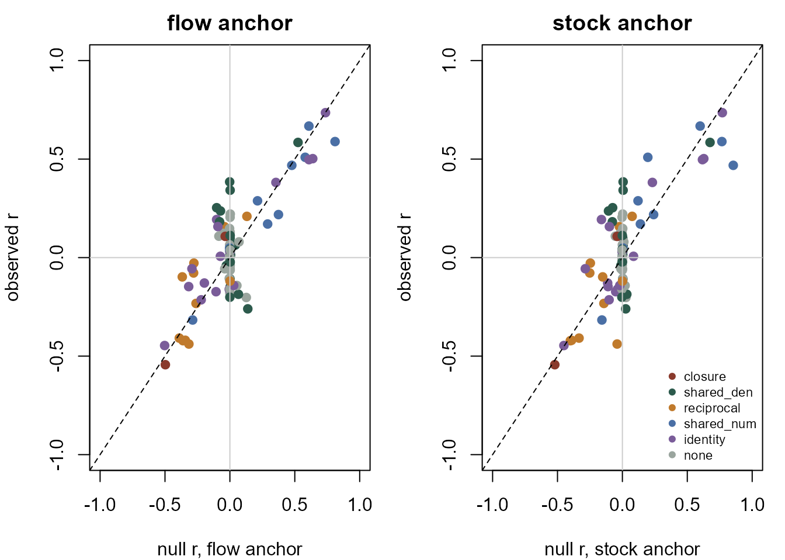
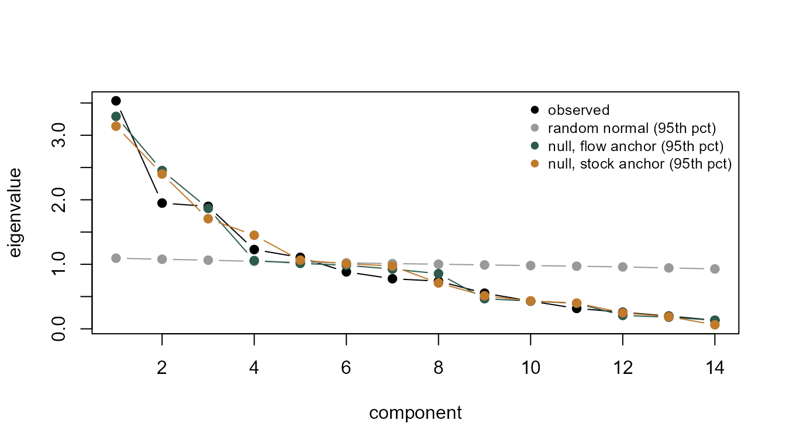

# Construction-induced correlation among fiscal ratios

``` r

library(fiscal)
library(psych)
library(splines)
set.seed(params$seed)
```

## The question

The fiscal health index factors a correlation matrix of 14 ratios. Those
ratios are built from about 20 Form 990 lines, and many of them share a
line: the same denominator (total expenses, total assets), the same
numerator (cash, the surplus), or a line that sits on top of one ratio
and underneath another. Two ratios that share a line correlate even when
nothing links the organizations’ finances. Shares of one whole correlate
negatively by definition.

This article asks three questions:

1.  **How much of each pairwise correlation is construction?** We build
    a *construction null*: the same 990 lines, shuffled across
    organizations so that every substantive relationship is destroyed
    while the arithmetic of the ratios, the accounting identities, and
    the pipeline (rules, imputation, winsorizing, asinh) are kept.
2.  **Does the construction null manufacture factors?** If PCA on
    arithmetic alone returns components that look like the health
    dimensions, those dimensions are at least partly definitional.
3.  **Is there one pre-processing fix that removes the artifact
    consistently across all 91 pairs**, without destroying variables or
    the matrix?
4.  **Does redesigning the variable set by link type work better** than
    transforming the ratios?

By default the article runs on the bundled `dat10k` sample (2021). Set
the `efile_path` parameter to an e-file extract (for example the
deduplicated 2023 file) to run it on a full tax year.

## 1. Components and ratios

The ratio rules and imputation are the measurement model from
[`vignette("variance-preserving-normalization")`](https://nonprofit-open-data-collective.github.io/fiscal/articles/variance-preserving-normalization.md).
They are split into two steps here, **lines** and **ratios**, so the
null can shuffle lines and then rebuild ratios exactly as the real data
are built.

``` r

fix64 <- function(x) {
  if (inherits(x, "integer64")) return(as.numeric(x))
  if (is.double(x)) {
    nz <- x[!is.na(x) & x != 0]
    if (length(nz) && all(abs(nz) < 1e-300)) {
      class(x) <- "integer64"
      return(as.numeric(x))
    }
  }
  x
}
pct_rank    <- function(x) { r <- rank(x, na.last = "keep"); (r - 0.5) / sum(!is.na(x)) }
rank_normal <- function(x) qnorm(pct_rank(x))
fill_median <- function(x) { x[is.na(x)] <- median(x, na.rm = TRUE); x }
winsor <- function(x, p = 0.01) {
  q <- quantile(x, c(p, 1 - p), na.rm = TRUE)
  pmin(pmax(x, q[[1]]), q[[2]])
}
winsor_normalize <- function(x, p = 0.01) {
  w  <- winsor(x, p)
  sk <- psych::skew(w)
  if (sk > 1) {
    s <- median(abs(w[w != 0])); w <- asinh(w / s)
  } else if (sk < -1) {
    r <- max(w) - w; s <- median(r[r != 0]); w <- -asinh(r / s)
  }
  as.numeric(scale(w))
}
cond_impute <- function(target, predictors, miss) {
  y   <- rank_normal(target)
  X   <- as.data.frame(lapply(predictors, rank_normal))
  fit <- stats::lm(y ~ ., data = cbind(y = y, X)[!miss, ])
  z   <- stats::predict(fit, newdata = X[miss, , drop = FALSE]) +
         stats::rnorm(sum(miss), 0, summary(fit)$sigma)
  out <- target
  out[miss] <- stats::quantile(target[!miss], stats::pnorm(z), names = FALSE, na.rm = TRUE)
  out
}
```

``` r

# Step 1: the 990 lines each ratio is built from.
efile_lines <- function(d) {
  d <- as.data.frame(d)
  d <- d[d$RETURN_TYPE == "990", ]
  fin <- function(f) {
    x <- if (f %in% names(d)) suppressWarnings(as.numeric(fix64(d[[f]]))) else rep(0, nrow(d))
    x[is.na(x)] <- 0
    x
  }
  k <- data.frame(
    cash    = fin("F9_10_ASSET_CASH_EOY") + fin("F9_10_ASSET_SAVING_EOY"),
    recv    = fin("F9_10_ASSET_PLEDGE_NET_EOY") + fin("F9_10_ASSET_ACC_NET_EOY"),
    othca   = fin("F9_10_ASSET_INV_SALE_EOY") + fin("F9_10_ASSET_EXP_PREPAID_EOY"),
    ap      = fin("F9_10_LIAB_ACC_PAYABLE_EOY"),
    cl      = fin("F9_10_LIAB_ACC_PAYABLE_EOY") + fin("F9_10_LIAB_GRANT_PAYABLE_EOY"),
    A = fin("F9_10_ASSET_TOT_EOY"), L = fin("F9_10_LIAB_TOT_EOY"),
    NA_eoy = fin("F9_10_NAFB_TOT_EOY"), NA_boy = fin("F9_10_NAFB_TOT_BOY"),
    UNA = fin("F9_10_NAFB_UNRESTRICT_EOY"), RES = fin("F9_10_NAFB_RESTRICT_EOY"),
    land = fin("F9_10_ASSET_LAND_BLDG_NET_EOY"), mtg = fin("F9_10_LIAB_MTG_NOTE_EOY"),
    R = fin("F9_08_REV_TOT_TOT"), E = fin("F9_09_EXP_TOT_TOT"), dep = fin("F9_09_EXP_DEPREC_TOT"),
    progrev = fin("F9_08_REV_PROG_TOT_TOT"),
    P = fin("F9_09_EXP_TOT_PROG"), M = fin("F9_09_EXP_TOT_MGMT"), Fu = fin("F9_09_EXP_TOT_FUNDR"))
  k[k$E > 0, ]
}

# Step 2: rules, conditional imputation, winsorize + normalize.
candidates <- c("current", "months_cash", "liquid_months", "cash_assets", "debt_assets",
                "payables_una", "surplus_margin", "return_assets", "na_growth", "self_suff",
                "admin_exp", "fundr_exp", "land_assets", "assets_rev")

lines_to_frame <- function(k) {
  k$ca   <- k$cash + k$recv + k$othca
  k$una  <- ifelse(k$UNA == 0 & k$RES == 0, k$NA_eoy, k$UNA)
  k$fsum <- k$P + k$M + k$Fu
  k$opE  <- ifelse(k$E - k$dep > 0, k$E - k$dep, k$E)
  rules <- with(k, data.frame(
    current        = ifelse(cl > 0, ca / cl, NA),
    months_cash    = (cash + recv) / (opE / 12),
    liquid_months  = (una - land + mtg) / (E / 12),
    cash_assets    = ifelse(A > 0, pmin(cash / A, 1), NA),
    debt_assets    = ifelse(A > 0, L / A, ifelse(L > 0, NA, 0)),
    payables_una   = ifelse(ap > 0, ap / (ap + pmax(una, 0)), 0),
    surplus_margin = (R - E) / pmax(R, E),
    return_assets  = ifelse(A > 0, (R - E) / A, NA),
    na_growth      = ifelse(NA_eoy == 0 & NA_boy == 0, 0,
                            (NA_eoy - NA_boy) / ((abs(NA_eoy) + abs(NA_boy)) / 2)),
    self_suff      = progrev / E,
    admin_exp      = ifelse(fsum > 0, M / fsum, NA),
    fundr_exp      = ifelse(fsum > 0, Fu / fsum, NA),
    land_assets    = ifelse(A > 0, land / A, 0),
    assets_rev     = A / ifelse(R > 0, R, E)))
  if (any(k$A <= 0 & k$L > 0))
    rules$debt_assets[k$A <= 0 & k$L > 0] <- max(rules$debt_assets, na.rm = TRUE)
  frame <- rules
  preds <- as.data.frame(lapply(
    rules[, c("liquid_months", "surplus_margin", "debt_assets", "months_cash")], fill_median))
  frame$current <- cond_impute(rules$current, preds, k$cl == 0)
  base_preds <- c("liquid_months", "surplus_margin", "months_cash", "self_suff")
  for (v in names(frame)) if (anyNA(frame[[v]])) {
    frame[[v]] <- cond_impute(frame[[v]], frame[, setdiff(base_preds, v), drop = FALSE],
                              is.na(frame[[v]]))
  }
  frame
}
normalize_frame <- function(frame) as.data.frame(lapply(frame[candidates], winsor_normalize))
lines_to_ratios <- function(k) normalize_frame(lines_to_frame(k))
```

``` r

if (nzchar(params$efile_path)) {
  efile <- readRDS(params$efile_path)
  source_label <- basename(params$efile_path)
} else {
  data(dat10k, package = "fiscal")
  efile <- dat10k
  source_label <- "dat10k (2021 sample)"
}
k <- efile_lines(efile)
rm(efile); invisible(gc())
frame_obs <- lines_to_frame(k)
X <- normalize_frame(frame_obs)
R_obs <- cor(X)
data.frame(source = source_label, organizations = format(nrow(X), big.mark = ","),
           ratios = ncol(X))
#>                 source organizations ratios
#> 1 dat10k (2021 sample)         5,995     14
```

## 2. The pairwise audit

Each of the 91 pairs is classified from the formulas alone, before
looking at any data:

- **closure**: both numerators are disjoint parts of the shared
  denominator; forced negative.
- **shared_den**: same denominator (or two denominators that are nearly
  the same flow, E and R); forced positive for positive numerators.
- **reciprocal**: a line on top of one ratio sits underneath the other;
  forced negative.
- **shared_num**: the same line in both numerators; forced in the
  direction of the signs.
- **identity**: linked through an accounting identity (NA = A - L,
  change in NA ~ R - E) rather than a shared line.
- **none**: no shared line.

`role` records whether the shared term is part of what *both* ratios are
meant to measure (**construct**), of neither (**artifact**), or of one
(**mixed**). `fix` is the repair that fits the pair taken alone.

``` r

audit <- read.table(sep = "|", header = TRUE, strip.white = TRUE, text = "
v1|v2|type|shared|sign|role|fix
current|months_cash|shared_num|cash, recv|+|construct|keep
current|liquid_months|identity|ca in una; cl in L|+|construct|keep
current|cash_assets|shared_num|cash|+|artifact|benchmark
current|debt_assets|reciprocal|ca in A; cl in L|-|mixed|benchmark
current|payables_una|reciprocal|ap|-|artifact|benchmark
current|surplus_margin|none||0||none
current|return_assets|reciprocal|ca in A (signed numerator)|mixed|artifact|benchmark
current|na_growth|none||0||none
current|self_suff|none||0||none
current|admin_exp|none||0||none
current|fundr_exp|none||0||none
current|land_assets|identity|ca and land in A|-|artifact|benchmark
current|assets_rev|shared_num|ca in A|+|mixed|benchmark
months_cash|liquid_months|shared_den|E; cash, recv in una|+|construct|keep
months_cash|cash_assets|shared_num|cash|+|artifact|benchmark
months_cash|debt_assets|reciprocal|cash, recv in A|-|artifact|benchmark
months_cash|payables_una|identity|cash, recv in una|-|artifact|benchmark
months_cash|surplus_margin|shared_den|E (signed numerator)|+|artifact|resid_E
months_cash|return_assets|shared_den|E (+); cash in A (-)|mixed|artifact|resid_E
months_cash|na_growth|identity|dNA ~ R - E|+|artifact|resid_E
months_cash|self_suff|shared_den|E|+|artifact|resid_E
months_cash|admin_exp|shared_den|E|+|artifact|resid_E
months_cash|fundr_exp|shared_den|E|+|artifact|resid_E
months_cash|land_assets|identity|cash and land in A|-|artifact|benchmark
months_cash|assets_rev|shared_num|cash in A; E ~ R|+|mixed|benchmark
liquid_months|cash_assets|identity|cash in una|+|artifact|benchmark
liquid_months|debt_assets|identity|L lowers una|-|mixed|benchmark
liquid_months|payables_una|reciprocal|una|-|artifact|benchmark
liquid_months|surplus_margin|shared_den|E (signed numerator)|+|artifact|resid_E
liquid_months|return_assets|shared_den|E (+); una in A (-)|mixed|artifact|resid_E
liquid_months|na_growth|identity|una in NA|mixed|mixed|benchmark
liquid_months|self_suff|shared_den|E|+|artifact|resid_E
liquid_months|admin_exp|shared_den|E|+|artifact|resid_E
liquid_months|fundr_exp|shared_den|E|+|artifact|resid_E
liquid_months|land_assets|shared_num|land (opposite signs)|-|construct|keep
liquid_months|assets_rev|identity|una in A; E ~ R|+|mixed|benchmark
cash_assets|debt_assets|shared_den|A|+|artifact|resid_A
cash_assets|payables_una|none||0||none
cash_assets|surplus_margin|none||0||none
cash_assets|return_assets|shared_den|A (signed numerator)|mixed|artifact|resid_A
cash_assets|na_growth|none||0||none
cash_assets|self_suff|none||0||none
cash_assets|admin_exp|none||0||none
cash_assets|fundr_exp|none||0||none
cash_assets|land_assets|closure|parts of A|-|artifact|log_ratio
cash_assets|assets_rev|reciprocal|A|-|artifact|benchmark
debt_assets|payables_una|shared_num|ap in L; una = A - L - RES|+|construct|keep
debt_assets|surplus_margin|none||0||none
debt_assets|return_assets|shared_den|A (signed numerator)|mixed|artifact|resid_A
debt_assets|na_growth|identity|NA = A - L|mixed|artifact|benchmark
debt_assets|self_suff|none||0||none
debt_assets|admin_exp|none||0||none
debt_assets|fundr_exp|none||0||none
debt_assets|land_assets|shared_den|A|+|mixed|resid_A
debt_assets|assets_rev|reciprocal|A|-|artifact|benchmark
payables_una|surplus_margin|none||0||none
payables_una|return_assets|none||0||none
payables_una|na_growth|identity|una in NA|mixed|artifact|benchmark
payables_una|self_suff|none||0||none
payables_una|admin_exp|none||0||none
payables_una|fundr_exp|none||0||none
payables_una|land_assets|none||0||none
payables_una|assets_rev|identity|una in A|-|artifact|benchmark
surplus_margin|return_assets|shared_num|R - E|+|construct|combine
surplus_margin|na_growth|identity|dNA ~ R - E|+|construct|combine
surplus_margin|self_suff|shared_num|progrev in R; E|+|artifact|resid_E
surplus_margin|admin_exp|shared_den|E|+|artifact|resid_E
surplus_margin|fundr_exp|shared_den|E|+|artifact|resid_E
surplus_margin|land_assets|none||0||none
surplus_margin|assets_rev|reciprocal|R|-|artifact|benchmark
return_assets|na_growth|identity|dNA ~ R - E|+|construct|combine
return_assets|self_suff|shared_num|progrev in R|+|artifact|benchmark
return_assets|admin_exp|shared_den|E|+|artifact|resid_E
return_assets|fundr_exp|shared_den|E|+|artifact|resid_E
return_assets|land_assets|shared_den|A (signed numerator)|mixed|artifact|resid_A
return_assets|assets_rev|reciprocal|A; R|-|artifact|benchmark
na_growth|self_suff|identity|progrev in R; dNA ~ R - E|+|artifact|benchmark
na_growth|admin_exp|none||0||none
na_growth|fundr_exp|none||0||none
na_growth|land_assets|none||0||none
na_growth|assets_rev|identity|NA in A|mixed|artifact|benchmark
self_suff|admin_exp|shared_den|E|+|artifact|resid_E
self_suff|fundr_exp|shared_den|E|+|artifact|resid_E
self_suff|land_assets|none||0||none
self_suff|assets_rev|reciprocal|progrev in R; E ~ R|mixed|artifact|benchmark
admin_exp|fundr_exp|closure|parts of E|-|artifact|log_ratio
admin_exp|land_assets|none||0||none
admin_exp|assets_rev|shared_den|E ~ R|+|artifact|resid_E
fundr_exp|land_assets|none||0||none
fundr_exp|assets_rev|shared_den|E ~ R|+|artifact|resid_E
land_assets|assets_rev|reciprocal|A|-|artifact|benchmark
", colClasses = "character", na.strings = NULL)
stopifnot(nrow(audit) == choose(length(candidates), 2))
audit$r_obs <- R_obs[cbind(audit$v1, audit$v2)]
table(audit$type)
#> 
#>    closure   identity       none reciprocal shared_den shared_num 
#>          2         16         28         11         24         10
table(audit$fix)
#> 
#> benchmark   combine      keep log_ratio      none   resid_A   resid_E 
#>        28         3         5         2        28         5        20
```

## 3. The construction null

The null keeps each organization’s size and every accounting identity,
and destroys everything else. Each 990 line is divided by a **size
reference**, shuffled across organizations independently of every other
line, multiplied back, and the totals are rebuilt from their parts (A =
sum of asset lines, L = sum of liability lines, NA = A - L, NA_boy from
the surplus). The ratios are then rebuilt with the same rules,
imputation, and transformations as the real data.

Coupling through a denominator is an artifact only to the extent that
the denominator varies independently of size, so the null depends on the
size reference. We run two:

- **flow anchor**: size = total expenses. Expense-denominator coupling
  is absent by definition; balance-sheet coupling is present.
- **stock anchor**: size = total assets. Expenses become an independent
  draw relative to assets, so expense-denominator coupling is present.

``` r

# `draw(x, line)` reassigns one size-scaled line across organizations. The
# default is an independent shuffle; section 10 swaps in a draw that plants
# known factors.
null_lines <- function(k, anchor = c("flow", "stock", "joint"),
                       draw = function(x, line) x[sample.int(length(x))]) {
  anchor <- match.arg(anchor)
  # "joint" (section 11): balance-sheet lines relative to assets, flow lines
  # relative to the organization's own expenses, which are never shuffled.
  gp     <- k$cl - k$ap
  otherA <- pmax(k$A - k$cash - k$recv - k$othca - k$land, 0)
  otherL <- pmax(k$L - k$cl - k$mtg, 0)
  res_sh <- ifelse(k$UNA >= 0 & k$RES > 0, k$RES / (k$UNA + k$RES), 0)
  na_oth <- (k$NA_eoy - k$NA_boy) - (k$R - k$E)
  size <- if (anchor == "flow") k$E else ifelse(k$A > 0, k$A, k$E)
  E    <- if (anchor == "stock") draw(k$E / size, "E") * size else k$E
  bs <- function(x, line) draw(x / size, line) * size   # balance-sheet lines
  fl <- function(x, line) draw(x / k$E, line) * E       # flow lines, relative to expenses
  out <- k
  out$cash <- bs(k$cash, "cash"); out$recv <- bs(k$recv, "recv"); out$othca <- bs(k$othca, "othca")
  out$land <- bs(k$land, "land"); out$ap <- bs(k$ap, "ap"); out$mtg <- bs(k$mtg, "mtg")
  out$cl <- out$ap + bs(gp, "gp")
  out$A  <- out$cash + out$recv + out$othca + out$land + bs(otherA, "otherA")
  out$L  <- out$cl + out$mtg + bs(otherL, "otherL")
  out$NA_eoy <- out$A - out$L
  out$RES <- ifelse(out$NA_eoy > 0, draw(res_sh, "res_sh") * out$NA_eoy, 0)
  out$UNA <- out$NA_eoy - out$RES
  out$E <- E
  out$R <- fl(k$R, "R"); out$dep <- fl(k$dep, "dep"); out$progrev <- fl(k$progrev, "progrev")
  out$P <- fl(k$P, "P"); out$M <- fl(k$M, "M"); out$Fu <- fl(k$Fu, "Fu")
  out$NA_boy <- out$NA_eoy - (out$R - out$E) - fl(na_oth, "na_oth")
  out
}
```

## 4. Candidate fixes

All fixes are applied to each variable, not to each correlation, except
F1, which is included to show why pairwise correction fails.

- **F0 as built**: the winsorized, normalized frame.
- **F1 pairwise null subtraction**: R_obs - (R_null - I), one adjustment
  per pair.
- **F2 common size residualization**: every ratio is regressed on
  natural splines of log expenses and log assets; the residuals are
  re-standardized.
- **F3 denominator-specific residualization**: each ratio is regressed
  only on the scale variable in its own denominator (E, A, or nothing
  for `current`, `payables_una`, and `na_growth`).

``` r

den_scale <- c(current = "none", months_cash = "E", liquid_months = "E", cash_assets = "A",
               debt_assets = "A", payables_una = "none", surplus_margin = "E",
               return_assets = "A", na_growth = "none", self_suff = "E", admin_exp = "E",
               fundr_exp = "E", land_assets = "A", assets_rev = "E")

residualize <- function(X, k, mode = c("common", "denominator")) {
  mode <- match.arg(mode)
  BE <- ns(log(k$E), df = 4)
  BA <- ns(log1p(pmax(k$A, 0)), df = 4)
  basis <- list(E = cbind(1, BE), A = cbind(1, BA), both = cbind(1, BE, BA), none = NULL)
  out <- lapply(names(X), function(v) {
    b <- if (mode == "common") "both" else den_scale[[v]]
    if (b == "none") return(X[[v]])
    as.numeric(scale(lm.fit(basis[[b]], X[[v]])$residuals))
  })
  names(out) <- names(X)
  as.data.frame(out)
}
size_basis <- cbind(1, ns(log(k$E), df = 4), ns(log1p(pmax(k$A, 0)), df = 4))
size_r2 <- vapply(names(X), function(v) 1 - var(lm.fit(size_basis, X[[v]])$residuals) / var(X[[v]]), 0)
round(sort(size_r2, decreasing = TRUE), 3)
#>     assets_rev    months_cash  liquid_months    cash_assets        current   payables_una    debt_assets 
#>          0.737          0.474          0.401          0.384          0.196          0.185          0.131 
#>    land_assets surplus_margin      self_suff  return_assets      na_growth      fundr_exp      admin_exp 
#>          0.117          0.110          0.065          0.057          0.047          0.039          0.032
```

`size_r2` is the share of each ratio’s variance explained by the size
splines. A value near 1 means residualizing on size erases the variable.

``` r

reps <- params$reps
run_null <- function(anchor) {
  lapply(seq_len(reps), function(i) {
    kn <- null_lines(k, anchor)
    Xn <- lines_to_ratios(kn)
    list(F0 = cor(Xn),
         F2 = cor(residualize(Xn, kn, "common")),
         F3 = cor(residualize(Xn, kn, "denominator")))
  })
}
null_runs <- list(flow = run_null("flow"), stock = run_null("stock"))

mean_mat <- function(runs, fix) Reduce(`+`, lapply(runs, `[[`, fix)) / length(runs)
eig_q95  <- function(runs, fix) apply(sapply(runs, function(r) eigen(r[[fix]], TRUE, only.values = TRUE)$values),
                                      1, quantile, 0.95)
R_null <- lapply(null_runs, function(runs) lapply(c(F0 = "F0", F2 = "F2", F3 = "F3"),
                                                   function(f) mean_mat(runs, f)))
for (a in names(R_null)) audit[[paste0("r_null_", a)]] <- R_null[[a]]$F0[cbind(audit$v1, audit$v2)]
```

## 5. How much of each correlation is construction?

``` r

type_col <- c(closure = "#8A3A2C", shared_den = "#2C5A4C", reciprocal = "#C07A2C",
              shared_num = "#4A6FA5", identity = "#7A5C99", none = "#9AA59E")
op <- par(mfrow = c(1, 2), mar = c(4, 4, 2, 1))
for (a in c("flow", "stock")) {
  x <- audit[[paste0("r_null_", a)]]
  plot(x, audit$r_obs, pch = 19, col = type_col[audit$type], xlim = c(-1, 1), ylim = c(-1, 1),
       xlab = paste("null r,", a, "anchor"), ylab = "observed r", main = paste(a, "anchor"))
  abline(0, 1, lty = 2); abline(h = 0, v = 0, col = "grey80")
}
legend("bottomright", legend = names(type_col), col = type_col, pch = 19, cex = 0.7, bty = "n")
```



``` r

par(op)
```

``` r

audit$r_null_max <- ifelse(abs(audit$r_null_flow) >= abs(audit$r_null_stock),
                           audit$r_null_flow, audit$r_null_stock)
by_type <- do.call(rbind, lapply(split(audit, audit$type), function(s) data.frame(
  type = s$type[1], pairs = nrow(s),
  mean_abs_obs = mean(abs(s$r_obs)),
  mean_abs_null_flow = mean(abs(s$r_null_flow)),
  mean_abs_null_stock = mean(abs(s$r_null_stock)),
  share_of_obs = sum(abs(s$r_null_max)) / sum(abs(s$r_obs)))))
knitr::kable(by_type[order(-by_type$mean_abs_null_flow), ], digits = 3, row.names = FALSE)
```

| type | pairs | mean_abs_obs | mean_abs_null_flow | mean_abs_null_stock | share_of_obs |
|:---|---:|---:|---:|---:|---:|
| shared_num | 10 | 0.331 | 0.364 | 0.308 | 1.215 |
| identity | 16 | 0.248 | 0.267 | 0.235 | 1.116 |
| closure | 2 | 0.326 | 0.267 | 0.281 | 0.862 |
| reciprocal | 11 | 0.237 | 0.252 | 0.187 | 1.095 |
| shared_den | 24 | 0.145 | 0.045 | 0.044 | 0.368 |
| none | 28 | 0.088 | 0.017 | 0.006 | 0.196 |

``` r


# Does the formula-based sign prediction match the null?
signed <- audit[audit$sign %in% c("+", "-") & abs(audit$r_null_max) >= 0.05, ]
sign_hit <- mean(sign(signed$r_null_max) == ifelse(signed$sign == "+", 1, -1))
none_ok  <- mean(abs(audit$r_null_max[audit$type == "none"]) < 0.05)
c(signed_pairs_with_null_r_ge_05 = nrow(signed), sign_agreement = round(sign_hit, 3),
  none_pairs_below_05 = round(none_ok, 3))
#> signed_pairs_with_null_r_ge_05                 sign_agreement            none_pairs_below_05 
#>                         32.000                          0.906                          0.821
```

``` r

top <- audit[order(-abs(audit$r_null_max)), c("v1", "v2", "type", "role", "sign",
                                               "r_obs", "r_null_flow", "r_null_stock")]
knitr::kable(head(top, 20), digits = 2, row.names = FALSE,
             caption = "The 20 pairs with the largest construction-null correlation")
```

| v1 | v2 | type | role | sign | r_obs | r_null_flow | r_null_stock |
|:---|:---|:---|:---|:---|---:|---:|---:|
| months_cash | assets_rev | shared_num | mixed | \+ | 0.47 | 0.48 | 0.85 |
| surplus_margin | return_assets | shared_num | construct | \+ | 0.59 | 0.81 | 0.77 |
| return_assets | na_growth | identity | construct | \+ | 0.74 | 0.74 | 0.77 |
| months_cash | liquid_months | shared_den | construct | \+ | 0.58 | 0.52 | 0.68 |
| liquid_months | assets_rev | identity | mixed | \+ | 0.50 | 0.64 | 0.63 |
| surplus_margin | na_growth | identity | construct | \+ | 0.50 | 0.61 | 0.62 |
| debt_assets | payables_una | shared_num | construct | \+ | 0.67 | 0.61 | 0.60 |
| current | months_cash | shared_num | construct | \+ | 0.51 | 0.58 | 0.20 |
| cash_assets | land_assets | closure | artifact | \- | -0.54 | -0.50 | -0.52 |
| liquid_months | debt_assets | identity | mixed | \- | -0.45 | -0.50 | -0.45 |
| current | debt_assets | reciprocal | mixed | \- | -0.42 | -0.36 | -0.40 |
| current | payables_una | reciprocal | artifact | \- | -0.42 | -0.34 | -0.39 |
| liquid_months | payables_una | reciprocal | artifact | \- | -0.41 | -0.39 | -0.33 |
| months_cash | cash_assets | shared_num | artifact | \+ | 0.22 | 0.37 | 0.24 |
| debt_assets | assets_rev | reciprocal | artifact | \- | -0.10 | -0.37 | -0.15 |
| current | liquid_months | identity | construct | \+ | 0.38 | 0.35 | 0.23 |
| payables_una | assets_rev | identity | artifact | \- | -0.15 | -0.32 | -0.11 |
| cash_assets | assets_rev | reciprocal | artifact | \- | -0.44 | -0.32 | -0.04 |
| na_growth | assets_rev | identity | artifact | mixed | -0.06 | -0.29 | -0.29 |
| current | assets_rev | shared_num | mixed | \+ | 0.17 | 0.29 | 0.14 |

The 20 pairs with the largest construction-null correlation {.table}

## 6. Does arithmetic alone produce components?

``` r

eig_obs <- eigen(R_obs, TRUE, only.values = TRUE)$values
eig_rand <- apply(replicate(20, eigen(cor(matrix(rnorm(nrow(X) * ncol(X)), ncol = ncol(X))),
                                      TRUE, only.values = TRUE)$values), 1, quantile, 0.95)
eig_flow  <- eig_q95(null_runs$flow, "F0")
eig_stock <- eig_q95(null_runs$stock, "F0")
matplot(seq_along(eig_obs), cbind(eig_obs, eig_rand, eig_flow, eig_stock), type = "b",
        pch = 19, lty = 1, col = c("black", "grey60", "#2C5A4C", "#C07A2C"),
        xlab = "component", ylab = "eigenvalue")
legend("topright", c("observed", "random normal (95th pct)", "null, flow anchor (95th pct)",
                     "null, stock anchor (95th pct)"),
       col = c("black", "grey60", "#2C5A4C", "#C07A2C"), pch = 19, bty = "n", cex = 0.8)
```



``` r

# Components retained: leading eigenvalues that exceed the reference, stopping at the first that does not.
n_retain <- function(obs, ref) { x <- c(obs > ref, FALSE); which.min(x) - 1 }
retain <- c(random_normal = n_retain(eig_obs, eig_rand), null_flow = n_retain(eig_obs, eig_flow),
            null_stock = n_retain(eig_obs, eig_stock))
retain
#> random_normal     null_flow    null_stock 
#>             5             1             1
knitr::kable(data.frame(component = seq_along(eig_obs), observed = eig_obs, random_normal = eig_rand,
                        null_flow = eig_flow, null_stock = eig_stock), digits = 2)
```

| component | observed | random_normal | null_flow | null_stock |
|----------:|---------:|--------------:|----------:|-----------:|
|         1 |     3.53 |          1.09 |      3.29 |       3.14 |
|         2 |     1.95 |          1.08 |      2.45 |       2.40 |
|         3 |     1.90 |          1.06 |      1.87 |       1.71 |
|         4 |     1.23 |          1.05 |      1.06 |       1.45 |
|         5 |     1.11 |          1.03 |      1.01 |       1.06 |
|         6 |     0.88 |          1.02 |      0.98 |       1.01 |
|         7 |     0.78 |          1.01 |      0.93 |       0.97 |
|         8 |     0.74 |          1.00 |      0.85 |       0.71 |
|         9 |     0.55 |          0.99 |      0.47 |       0.51 |
|        10 |     0.43 |          0.98 |      0.43 |       0.43 |
|        11 |     0.32 |          0.97 |      0.39 |       0.40 |
|        12 |     0.26 |          0.96 |      0.21 |       0.25 |
|        13 |     0.20 |          0.94 |      0.18 |       0.19 |
|        14 |     0.13 |          0.93 |      0.13 |       0.06 |

``` r

anchors <- c(performance = "return_assets", reserves = "months_cash",
             leverage = "debt_assets", asset_structure = "land_assets",
             expense = "fundr_exp")
pca5 <- function(R) {
  L <- unclass(psych::principal(R, nfactors = 5, rotate = "oblimin", n.obs = nrow(X))$loadings)
  perms <- function(n) if (n == 1) list(1L) else
    do.call(c, lapply(seq_len(n), function(i) lapply(perms(n - 1), function(p) c(i, setdiff(seq_len(n), i)[p]))))
  P <- perms(5)
  A <- abs(L[anchors, , drop = FALSE])
  best <- P[[which.max(vapply(P, function(p) sum(A[cbind(1:5, p)]), 0))]]
  L <- L[, best]
  L <- sweep(L, 2, sign(diag(L[anchors, ])), `*`)   # anchor loads positively
  colnames(L) <- names(anchors)
  L
}
show_loadings <- function(L, caption) {
  L[abs(L) < 0.30] <- NA
  knitr::kable(L, digits = 2, caption = caption)
}
congruence <- function(A, B) diag(psych::factor.congruence(A, B, digits = 3))

L_obs <- pca5(R_obs)
show_loadings(L_obs, "F0 as built: five-component oblimin loadings")
```

|                | performance | reserves | leverage | asset_structure | expense |
|:---------------|------------:|---------:|---------:|----------------:|--------:|
| current        |          NA |     0.45 |    -0.37 |              NA |      NA |
| months_cash    |          NA |     0.84 |       NA |              NA |      NA |
| liquid_months  |          NA |     0.73 |       NA |              NA |      NA |
| cash_assets    |          NA |       NA |       NA |           -0.89 |      NA |
| debt_assets    |          NA |       NA |     0.80 |              NA |      NA |
| payables_una   |          NA |       NA |     0.86 |              NA |      NA |
| surplus_margin |        0.77 |       NA |       NA |              NA |      NA |
| return_assets  |        0.90 |       NA |       NA |              NA |      NA |
| na_growth      |        0.87 |       NA |       NA |              NA |      NA |
| self_suff      |          NA |       NA |       NA |              NA |   -0.64 |
| admin_exp      |          NA |     0.40 |     0.46 |              NA |    0.35 |
| fundr_exp      |          NA |       NA |       NA |              NA |    0.81 |
| land_assets    |          NA |       NA |       NA |            0.81 |      NA |
| assets_rev     |          NA |     0.71 |       NA |            0.52 |      NA |

F0 as built: five-component oblimin loadings {.table}

``` r

L_null_flow  <- pca5(R_null$flow$F0)
L_null_stock <- pca5(R_null$stock$F0)
show_loadings(L_null_flow, "Construction null, flow anchor")
```

|                | performance | reserves | leverage | asset_structure | expense |
|:---------------|------------:|---------:|---------:|----------------:|--------:|
| current        |          NA |       NA |    -0.64 |           -0.33 |      NA |
| months_cash    |          NA |       NA |    -0.66 |           -0.50 |      NA |
| liquid_months  |          NA |       NA |    -0.81 |              NA |      NA |
| cash_assets    |          NA |       NA |       NA |           -0.88 |      NA |
| debt_assets    |          NA |       NA |     0.76 |              NA |      NA |
| payables_una   |          NA |       NA |     0.70 |              NA |      NA |
| surplus_margin |        0.90 |       NA |       NA |              NA |      NA |
| return_assets  |        0.93 |       NA |       NA |              NA |      NA |
| na_growth      |        0.86 |       NA |       NA |              NA |      NA |
| self_suff      |          NA |       -1 |       NA |              NA |      NA |
| admin_exp      |          NA |       NA |       NA |              NA |   -0.72 |
| fundr_exp      |          NA |       NA |       NA |              NA |    0.72 |
| land_assets    |          NA |       NA |       NA |            0.76 |      NA |
| assets_rev     |          NA |       NA |    -0.70 |              NA |      NA |

Construction null, flow anchor {.table}

``` r

show_loadings(L_null_stock, "Construction null, stock anchor")
```

|                | performance | reserves | leverage | asset_structure | expense |
|:---------------|------------:|---------:|---------:|----------------:|--------:|
| current        |          NA |       NA |    -0.69 |              NA |      NA |
| months_cash    |          NA |     0.96 |       NA |              NA |      NA |
| liquid_months  |          NA |     0.75 |    -0.30 |              NA |      NA |
| cash_assets    |          NA |       NA |       NA |           -0.87 |      NA |
| debt_assets    |          NA |       NA |     0.85 |              NA |      NA |
| payables_una   |          NA |       NA |     0.85 |              NA |      NA |
| surplus_margin |        0.90 |       NA |       NA |              NA |      NA |
| return_assets  |        0.94 |       NA |       NA |              NA |      NA |
| na_growth      |        0.86 |       NA |       NA |              NA |      NA |
| self_suff      |          NA |       NA |       NA |              NA |      NA |
| admin_exp      |          NA |       NA |       NA |              NA |   -0.72 |
| fundr_exp      |          NA |       NA |       NA |              NA |    0.72 |
| land_assets    |          NA |       NA |       NA |            0.87 |      NA |
| assets_rev     |          NA |     0.94 |       NA |              NA |      NA |

Construction null, stock anchor {.table}

``` r

round(rbind(null_flow = congruence(L_null_flow, L_obs),
            null_stock = congruence(L_null_stock, L_obs)), 2)
#>            performance reserves leverage asset_structure expense
#> null_flow         0.98     0.01     0.69            0.90    0.29
#> null_stock        0.99     0.89     0.89            0.95    0.33
```

Congruence here compares each null component with the observed component
of the same label. Values of 0.85 or more mean the arithmetic alone
reproduces that component’s loading pattern.

## 7. Do the fixes remove the artifact consistently?

``` r

off <- function(R) R[upper.tri(R)]
fix_null <- do.call(rbind, lapply(names(R_null), function(a) do.call(rbind, lapply(
  c("F0", "F2", "F3"), function(f) {
    r <- off(R_null[[a]][[f]])
    data.frame(anchor = a, fix = f, mean_abs_null_r = mean(abs(r)),
               max_abs_null_r = max(abs(r)), pairs_abs_ge_10 = sum(abs(r) >= 0.10))
  }))))
knitr::kable(fix_null, digits = 3, row.names = FALSE)
```

| anchor | fix | mean_abs_null_r | max_abs_null_r | pairs_abs_ge_10 |
|:-------|:----|----------------:|---------------:|----------------:|
| flow   | F0  |           0.140 |          0.810 |              33 |
| flow   | F2  |           0.105 |          0.817 |              22 |
| flow   | F3  |           0.131 |          0.813 |              29 |
| stock  | F0  |           0.117 |          0.854 |              29 |
| stock  | F2  |           0.103 |          0.775 |              22 |
| stock  | F3  |           0.113 |          0.806 |              26 |

``` r


# Remaining null correlation by pair type, after each fix
pair_idx <- cbind(match(audit$v1, candidates), match(audit$v2, candidates))
type_fix <- do.call(rbind, lapply(names(R_null), function(a) {
  m <- sapply(c("F0", "F2", "F3"), function(f) tapply(abs(R_null[[a]][[f]][pair_idx]), audit$type, mean))
  data.frame(anchor = a, type = rownames(m), m, row.names = NULL)
}))
knitr::kable(type_fix, digits = 3, row.names = FALSE,
             caption = "Mean |null r| by pair type and fix")
```

| anchor | type       |    F0 |    F2 |    F3 |
|:-------|:-----------|------:|------:|------:|
| flow   | closure    | 0.267 | 0.257 | 0.263 |
| flow   | identity   | 0.267 | 0.204 | 0.264 |
| flow   | none       | 0.017 | 0.003 | 0.011 |
| flow   | reciprocal | 0.252 | 0.168 | 0.200 |
| flow   | shared_den | 0.045 | 0.015 | 0.036 |
| flow   | shared_num | 0.364 | 0.345 | 0.378 |
| stock  | closure    | 0.281 | 0.281 | 0.281 |
| stock  | identity   | 0.235 | 0.206 | 0.232 |
| stock  | none       | 0.006 | 0.004 | 0.006 |
| stock  | reciprocal | 0.187 | 0.180 | 0.167 |
| stock  | shared_den | 0.044 | 0.021 | 0.037 |
| stock  | shared_num | 0.308 | 0.286 | 0.311 |

Mean \|null r\| by pair type and fix {.table}

``` r

X_F2 <- residualize(X, k, "common")
X_F3 <- residualize(X, k, "denominator")
R_F2 <- cor(X_F2); R_F3 <- cor(X_F3)
R_F1 <- R_obs - (R_null$flow$F0 - diag(ncol(X)))
R_F1s <- R_obs - (R_null$stock$F0 - diag(ncol(X)))

min_eig <- sapply(list(F0 = R_obs, F1_flow = R_F1, F1_stock = R_F1s, F2 = R_F2, F3 = R_F3),
                  function(R) min(eigen(R, TRUE, only.values = TRUE)$values))
round(min_eig, 3)
#>       F0  F1_flow F1_stock       F2       F3 
#>    0.133   -0.320   -0.304    0.193    0.177

ev <- function(R) eigen(R, TRUE, only.values = TRUE)$values
retain_fix <- rbind(
  F0 = c(n_retain(eig_obs, eig_flow), n_retain(eig_obs, eig_stock)),
  F2 = c(n_retain(ev(R_F2), eig_q95(null_runs$flow, "F2")),
         n_retain(ev(R_F2), eig_q95(null_runs$stock, "F2"))),
  F3 = c(n_retain(ev(R_F3), eig_q95(null_runs$flow, "F3")),
         n_retain(ev(R_F3), eig_q95(null_runs$stock, "F3"))))
colnames(retain_fix) <- c("vs null flow", "vs null stock")
retain_fix
#>    vs null flow vs null stock
#> F0            1             1
#> F2            1             1
#> F3            1             1

R_F1pd <- as.matrix(Matrix::nearPD(R_F1, corr = TRUE)$mat)
dimnames(R_F1pd) <- dimnames(R_obs)
L_F1 <- pca5(R_F1pd); L_F2 <- pca5(R_F2); L_F3 <- pca5(R_F3)
show_loadings(L_F1, "F1 pairwise null subtraction (flow anchor, nearest PD)")
```

|                | performance | reserves | leverage | asset_structure | expense |
|:---------------|------------:|---------:|---------:|----------------:|--------:|
| current        |          NA |       NA |       NA |              NA |      NA |
| months_cash    |        0.39 |     0.46 |       NA |              NA |      NA |
| liquid_months  |        0.42 |     0.41 |    -0.35 |              NA |      NA |
| cash_assets    |          NA |       NA |    -0.49 |           -0.40 |      NA |
| debt_assets    |          NA |       NA |       NA |            0.67 |      NA |
| payables_una   |          NA |       NA |       NA |            0.35 |      NA |
| surplus_margin |          NA |     0.94 |       NA |              NA |      NA |
| return_assets  |        0.82 |       NA |       NA |              NA |      NA |
| na_growth      |        0.54 |       NA |       NA |              NA |      NA |
| self_suff      |          NA |       NA |       NA |            0.51 |   -0.44 |
| admin_exp      |          NA |       NA |       NA |              NA |    0.59 |
| fundr_exp      |          NA |       NA |       NA |              NA |    0.73 |
| land_assets    |          NA |       NA |       NA |            0.70 |      NA |
| assets_rev     |          NA |       NA |     0.80 |              NA |      NA |

F1 pairwise null subtraction (flow anchor, nearest PD) {.table}

``` r

show_loadings(L_F2, "F2 common size residualization")
```

|                | performance | reserves | leverage | asset_structure | expense |
|:---------------|------------:|---------:|---------:|----------------:|--------:|
| current        |          NA |     0.60 |    -0.46 |              NA |      NA |
| months_cash    |          NA |     0.85 |       NA |              NA |      NA |
| liquid_months  |          NA |       NA |       NA |           -0.77 |      NA |
| cash_assets    |          NA |     0.77 |       NA |              NA |      NA |
| debt_assets    |          NA |       NA |     0.78 |              NA |      NA |
| payables_una   |          NA |       NA |     0.86 |              NA |      NA |
| surplus_margin |        0.83 |       NA |       NA |              NA |      NA |
| return_assets  |        0.84 |       NA |       NA |              NA |      NA |
| na_growth      |        0.80 |       NA |       NA |              NA |      NA |
| self_suff      |          NA |       NA |       NA |              NA |   -0.70 |
| admin_exp      |          NA |       NA |     0.36 |           -0.35 |      NA |
| fundr_exp      |          NA |       NA |       NA |              NA |    0.82 |
| land_assets    |          NA |       NA |       NA |            0.78 |      NA |
| assets_rev     |       -0.73 |       NA |       NA |              NA |      NA |

F2 common size residualization {.table}

``` r

show_loadings(L_F3, "F3 denominator-specific residualization")
```

|                | performance | reserves | leverage | asset_structure | expense |
|:---------------|------------:|---------:|---------:|----------------:|--------:|
| current        |          NA |       NA |    -0.56 |              NA |      NA |
| months_cash    |          NA |     0.66 |       NA |           -0.44 |      NA |
| liquid_months  |          NA |     0.64 |       NA |              NA |      NA |
| cash_assets    |          NA |       NA |       NA |           -0.89 |      NA |
| debt_assets    |          NA |       NA |     0.81 |              NA |      NA |
| payables_una   |          NA |       NA |     0.89 |              NA |      NA |
| surplus_margin |        0.78 |       NA |       NA |              NA |      NA |
| return_assets  |        0.89 |       NA |       NA |              NA |      NA |
| na_growth      |        0.87 |       NA |       NA |              NA |      NA |
| self_suff      |          NA |       NA |       NA |              NA |   -0.72 |
| admin_exp      |          NA |     0.40 |     0.33 |              NA |    0.31 |
| fundr_exp      |          NA |       NA |       NA |              NA |    0.76 |
| land_assets    |          NA |       NA |       NA |            0.77 |      NA |
| assets_rev     |          NA |     0.85 |       NA |              NA |      NA |

F3 denominator-specific residualization {.table}

``` r

round(rbind(F1 = congruence(L_F1, L_obs), F2 = congruence(L_F2, L_obs),
            F3 = congruence(L_F3, L_obs)), 2)
#>    performance reserves leverage asset_structure expense
#> F1        0.64     0.60     0.24            0.57    0.90
#> F2        0.93     0.40     0.99            0.46    0.97
#> F3        1.00     0.95     0.98            0.95    0.99
```

## 8. Findings

**Most of the correlation structure is construction.** For closure,
reciprocal, identity, and shared-numerator pairs, the construction null
reproduces 86% or more of the observed absolute correlation. Only
shared-denominator pairs (37%) and unlinked pairs (20%) carry mostly
non-arithmetic correlation. The formula-based sign prediction matches
the null for 91% of the 32 pairs where the null correlation reaches
0.05.

**Arithmetic alone reproduces the dimensions.** With assets as the size
reference, PCA on the null matrix recovers the observed performance,
reserves, leverage, and asset-structure components with congruence 0.99,
0.89, 0.89, and 0.95. The null’s leading eigenvalues (3.14, 2.40, 1.71)
sit next to the observed ones (3.53, 1.95, 1.90). Against a construction
null, parallel analysis retains 1 component, not 5. The components are
shared-ingredient components: `surplus_margin`, `return_assets`, and
`na_growth` are one number (the surplus) on three scales, and
`months_cash`, `liquid_months`, and `assets_rev` all inherit the ratio
of assets to expenses.

**No single fix is consistent across the set.**

- *Pairwise null subtraction (F1)* produces an invalid correlation
  matrix (smallest eigenvalue -0.32), and after projection to the
  nearest valid matrix the components no longer resemble any
  interpretable structure.
- *Common size residualization (F2)* removes most shared-denominator
  artifact (mean \|null r\| for those pairs falls from 0.045 to 0.015),
  but leaves closure and shared-numerator artifact untouched and erases
  74% of `assets_rev`. Reserves and asset structure are rebuilt around
  what is left (congruence 0.40 and 0.46).
- *Denominator-specific residualization (F3)* keeps the matrix valid and
  the structure intact, but lowers the average null correlation only
  from 0.140 to 0.131.

The artifact lives in different places for different link types, so the
repair has to be chosen by link type. The one step that applies to all
91 pairs is the construction null itself, used as a benchmark: for
retention decisions, for reading loadings, and for reporting how much of
each correlation exceeds what the arithmetic implies.

## 9. Repairing the variable set by link type

Section 7 transformed the 14 ratios. This section instead **redesigns
the set**, choosing one repair per link type, and runs the redesigned
set through the same construction null.

| Link type | Ratios affected | Repair | New variable |
|----|----|----|----|
| Closure | `cash_assets`, `land_assets` | one bounded contrast, 0 when both parts are 0 | `cash_land` = (cash - land) / (cash + land) |
| Closure | `admin_exp`, `fundr_exp` | one bounded contrast, imputed when both parts are 0 | `admin_fundr` = (M - Fu) / (M + Fu) |
| Shared numerator, construct | `surplus_margin`, `return_assets`, `na_growth` | enter the surplus once | `surplus` = mean of the three normalized ratios |
| Stock over flow | `months_cash`, `liquid_months`, `assets_rev` | split into a share of assets and one scale | `liquid_assets_share` = (cash + recv) / A; `una_liquid_share` = (una - land + mtg) / A; `assets_exp` = A / E |
| Reciprocal, identity | `current`, `debt_assets`, `payables_una`, `self_suff` | kept as built | unchanged |

Because months of cash = 12 x `liquid_assets_share` x `assets_exp` (up
to the depreciation adjustment), the redesign keeps the information in
the original ratios. The difference is that the assets-to-expenses scale
enters once, as its own variable, instead of being hidden in three.

``` r

redesign_vars <- c("current", "liquid_assets_share", "una_liquid_share", "assets_exp",
                   "cash_land", "debt_assets", "payables_una", "surplus", "self_suff",
                   "admin_fundr")

redesign <- function(k, frame) {
  una <- ifelse(k$UNA == 0 & k$RES == 0, k$NA_eoy, k$UNA)
  new <- with(k, data.frame(
    liquid_assets_share = ifelse(A > 0, pmin((cash + recv) / A, 1), NA),
    una_liquid_share    = ifelse(A > 0, (una - land + mtg) / A, NA),
    assets_exp          = A / E,
    cash_land           = ifelse(cash + land > 0, pmin(pmax((cash - land) / (cash + land), -1), 1), 0),
    admin_fundr         = ifelse(M + Fu > 0, pmin(pmax((M - Fu) / (M + Fu), -1), 1), NA)))
  base_preds <- c("liquid_months", "surplus_margin", "months_cash", "self_suff")
  for (v in names(new)) if (anyNA(new[[v]])) {
    new[[v]] <- cond_impute(new[[v]], frame[, base_preds], is.na(new[[v]]))
  }
  Z <- as.data.frame(lapply(cbind(frame[c("current", "debt_assets", "payables_una", "self_suff",
                                          "surplus_margin", "return_assets", "na_growth")], new),
                            winsor_normalize))
  Z$surplus <- as.numeric(scale(rowMeans(Z[c("surplus_margin", "return_assets", "na_growth")])))
  Z[redesign_vars]
}

X_S2 <- redesign(k, frame_obs)
R_S2 <- cor(X_S2)
```

``` r

set.seed(params$seed + 1)
run_null_S2 <- function(anchor) {
  lapply(seq_len(reps), function(i) {
    kn <- null_lines(k, anchor)
    cor(redesign(kn, lines_to_frame(kn)))
  })
}
null_S2 <- list(flow = run_null_S2("flow"), stock = run_null_S2("stock"))
R_null_S2 <- lapply(null_S2, function(runs) Reduce(`+`, runs) / length(runs))
eig_q95_S2 <- lapply(null_S2, function(runs)
  apply(sapply(runs, function(r) eigen(r, TRUE, only.values = TRUE)$values), 1, quantile, 0.95))
eig_rand_S2 <- apply(replicate(20, eigen(cor(matrix(rnorm(nrow(X_S2) * ncol(X_S2)), ncol = ncol(X_S2))),
                                         TRUE, only.values = TRUE)$values), 1, quantile, 0.95)
```

### 9.1 How much construction is left?

``` r

set_summary <- function(label, R_o, R_f, R_s, e_rand, e_f, e_s) {
  up <- upper.tri(R_o)
  data.frame(set = label, variables = ncol(R_o), pairs = sum(up),
             mean_abs_obs = mean(abs(R_o[up])),
             mean_abs_null_flow = mean(abs(R_f[up])), mean_abs_null_stock = mean(abs(R_s[up])),
             share_pairs_null_ge_10 = mean(pmax(abs(R_f[up]), abs(R_s[up])) >= 0.10),
             retain_random = n_retain(ev(R_o), e_rand),
             retain_null_flow = n_retain(ev(R_o), e_f), retain_null_stock = n_retain(ev(R_o), e_s))
}
s2_summary <- rbind(
  set_summary("F0: 14 ratios as built", R_obs, R_null$flow$F0, R_null$stock$F0, eig_rand, eig_flow, eig_stock),
  set_summary("S2: redesigned set", R_S2, R_null_S2$flow, R_null_S2$stock,
              eig_rand_S2, eig_q95_S2$flow, eig_q95_S2$stock))
knitr::kable(s2_summary, digits = 3, row.names = FALSE)
```

| set | variables | pairs | mean_abs_obs | mean_abs_null_flow | mean_abs_null_stock | share_pairs_null_ge_10 | retain_random | retain_null_flow | retain_null_stock |
|:---|---:|---:|---:|---:|---:|---:|---:|---:|---:|
| F0: 14 ratios as built | 14 | 91 | 0.181 | 0.140 | 0.117 | 0.385 | 5 | 1 | 1 |
| S2: redesigned set | 10 | 45 | 0.216 | 0.153 | 0.120 | 0.444 | 3 | 1 | 3 |

``` r


knitr::kable(data.frame(component = seq_len(ncol(R_S2)), observed = ev(R_S2), random_normal = eig_rand_S2,
                        null_flow = eig_q95_S2$flow, null_stock = eig_q95_S2$stock),
             digits = 2, caption = "Redesigned set: eigenvalues")
```

| component | observed | random_normal | null_flow | null_stock |
|----------:|---------:|--------------:|----------:|-----------:|
|         1 |     3.14 |          1.08 |      2.63 |       2.57 |
|         2 |     1.87 |          1.06 |      2.04 |       1.81 |
|         3 |     1.22 |          1.04 |      1.04 |       1.10 |
|         4 |     0.94 |          1.02 |      1.01 |       1.02 |
|         5 |     0.84 |          1.01 |      1.00 |       1.00 |
|         6 |     0.69 |          1.00 |      0.84 |       0.88 |
|         7 |     0.56 |          0.99 |      0.64 |       0.77 |
|         8 |     0.33 |          0.98 |      0.44 |       0.48 |
|         9 |     0.23 |          0.96 |      0.29 |       0.34 |
|        10 |     0.18 |          0.95 |      0.21 |       0.19 |

Redesigned set: eigenvalues {.table}

``` r

ij <- which(upper.tri(R_S2), arr.ind = TRUE)
s2_pairs <- data.frame(v1 = redesign_vars[ij[, 1]], v2 = redesign_vars[ij[, 2]],
                       r_obs = R_S2[ij], r_null_flow = R_null_S2$flow[ij],
                       r_null_stock = R_null_S2$stock[ij])
# Beyond null: the observed correlation minus the null that lies closer to it.
s2_pairs$beyond_null <- with(s2_pairs, ifelse(abs(r_obs - r_null_flow) < abs(r_obs - r_null_stock),
                                              r_obs - r_null_flow, r_obs - r_null_stock))
s2_pairs <- s2_pairs[order(-abs(s2_pairs$r_obs)), ]
knitr::kable(head(s2_pairs, 20), digits = 2, row.names = FALSE,
             caption = "Redesigned set: the 20 largest observed correlations and their nulls")
```

| v1 | v2 | r_obs | r_null_flow | r_null_stock | beyond_null |
|:---|:---|---:|---:|---:|---:|
| liquid_assets_share | cash_land | 0.69 | 0.66 | 0.69 | 0.00 |
| una_liquid_share | debt_assets | -0.67 | -0.61 | -0.68 | 0.01 |
| debt_assets | payables_una | 0.67 | 0.61 | 0.60 | 0.06 |
| una_liquid_share | cash_land | 0.62 | 0.40 | 0.38 | 0.23 |
| una_liquid_share | payables_una | -0.51 | -0.42 | -0.47 | -0.04 |
| liquid_assets_share | assets_exp | -0.46 | -0.41 | -0.07 | -0.05 |
| liquid_assets_share | una_liquid_share | 0.43 | 0.17 | 0.23 | 0.21 |
| current | debt_assets | -0.42 | -0.35 | -0.40 | -0.02 |
| current | payables_una | -0.42 | -0.34 | -0.40 | -0.02 |
| current | una_liquid_share | 0.34 | 0.28 | 0.28 | 0.06 |
| cash_land | debt_assets | -0.28 | 0.10 | 0.05 | -0.33 |
| current | assets_exp | 0.27 | 0.31 | 0.15 | -0.04 |
| current | cash_land | 0.25 | 0.16 | 0.08 | 0.09 |
| assets_exp | surplus | 0.23 | -0.11 | -0.11 | 0.34 |
| current | liquid_assets_share | 0.23 | 0.22 | 0.13 | 0.01 |
| self_suff | admin_fundr | 0.22 | 0.00 | 0.00 | 0.21 |
| debt_assets | self_suff | 0.20 | 0.00 | 0.00 | 0.20 |
| debt_assets | surplus | -0.20 | 0.02 | 0.00 | -0.21 |
| current | surplus | 0.19 | -0.04 | -0.02 | 0.21 |
| assets_exp | payables_una | -0.19 | -0.34 | -0.12 | -0.07 |

Redesigned set: the 20 largest observed correlations and their nulls
{.table}

The stock-over-flow decomposition is the clearest test. Before the
redesign, `months_cash` and `liquid_months` had a null correlation of
0.52 (flow) and 0.68 (stock). Their asset-share counterparts have 0.17
and 0.23.

### 9.2 What structure does the redesigned set carry?

``` r

perms <- function(n) if (n == 1) list(1L) else
  do.call(c, lapply(seq_len(n), function(i) lapply(perms(n - 1), function(p) c(i, setdiff(seq_len(n), i)[p]))))
pca_k <- function(R, nf) {
  L <- unclass(psych::principal(R, nfactors = nf, rotate = if (nf > 1) "oblimin" else "none",
                                n.obs = nrow(X))$loadings)
  colnames(L) <- paste0("C", seq_len(nf))
  L
}
# Reorder and re-sign the columns of L to best match ref; return matched loadings and congruence.
match_to <- function(L, ref) {
  C <- psych::factor.congruence(L, ref, digits = 3)
  P <- perms(ncol(ref))
  p <- P[[which.max(vapply(P, function(q) sum(abs(C[cbind(q, seq_len(ncol(ref)))])), 0))]]
  s <- sign(C[cbind(p, seq_len(ncol(ref)))])
  L <- sweep(L[, p, drop = FALSE], 2, s, `*`)
  colnames(L) <- colnames(ref)
  list(L = L, congruence = setNames(abs(C[cbind(p, seq_len(ncol(ref)))]), colnames(ref)))
}

k_S2 <- max(2, n_retain(ev(R_S2), eig_rand_S2))
L_S2 <- pca_k(R_S2, k_S2)
L_S2_flow  <- match_to(pca_k(R_null_S2$flow, k_S2), L_S2)
L_S2_stock <- match_to(pca_k(R_null_S2$stock, k_S2), L_S2)
show_loadings(L_S2, paste0("Redesigned set, observed: ", k_S2, " components"))
```

|                     |    C1 |    C2 |   C3 |
|:--------------------|------:|------:|-----:|
| current             |  0.69 |    NA |   NA |
| liquid_assets_share |    NA |  0.89 |   NA |
| una_liquid_share    |  0.67 |  0.47 |   NA |
| assets_exp          |  0.51 | -0.71 |   NA |
| cash_land           |    NA |  0.77 |   NA |
| debt_assets         | -0.81 |    NA |   NA |
| payables_una        | -0.79 |    NA |   NA |
| surplus             |  0.48 |    NA |   NA |
| self_suff           |    NA |    NA | 0.76 |
| admin_fundr         |    NA |    NA | 0.76 |

Redesigned set, observed: 3 components {.table}

``` r

show_loadings(L_S2_stock$L, "Redesigned set, construction null (stock anchor)")
```

|                     |    C1 |   C2 |    C3 |
|:--------------------|------:|-----:|------:|
| current             |  0.60 |   NA |    NA |
| liquid_assets_share |    NA | 0.90 |    NA |
| una_liquid_share    |  0.76 | 0.34 |    NA |
| assets_exp          |    NA |   NA | -0.65 |
| cash_land           |    NA | 0.92 |    NA |
| debt_assets         | -0.89 |   NA |    NA |
| payables_una        | -0.81 |   NA |    NA |
| surplus             |    NA |   NA |  0.81 |
| self_suff           |    NA |   NA |    NA |
| admin_fundr         |    NA |   NA |    NA |

Redesigned set, construction null (stock anchor) {.table}

``` r

round(rbind(null_flow = L_S2_flow$congruence, null_stock = L_S2_stock$congruence), 2)
#>              C1   C2   C3
#> null_flow  0.94 0.95 0.33
#> null_stock 0.93 0.89 0.18
```

### 9.3 Findings for the redesign

- **Construction correlation.** Mean \|null r\| is 0.153 (flow) and
  0.120 (stock) in the redesigned set, against 0.140 and 0.117 for the
  as-built ratios. The share of pairs with a null correlation of 0.10 or
  more is 44%, against 38%. The observed mean \|r\| is 0.216, against
  0.181.
- **Where the construction correlation now sits.** The largest null
  correlations are liquid_assets_share x cash_land (0.69);
  una_liquid_share x debt_assets (-0.68); debt_assets x payables_una
  (0.61); una_liquid_share x payables_una (-0.47). Putting every
  balance-sheet quantity over total assets turns stock-over-flow
  coupling into composition: the asset shares, `debt_assets`, and
  `una_liquid_share` are parts of the same balance sheet.
- **Retention against the null.** Parallel analysis keeps 3 components
  against random data, and 1 (flow) and 3 (stock) against the
  construction null, compared with 1 and 1 for the as-built ratios.
- **How much of the remaining structure is arithmetic.** Congruence of
  the null components with the observed 3-component solution is 0.93,
  0.89, 0.18 (stock anchor) and 0.94, 0.95, 0.33 (flow anchor).
- **What the data add beyond arithmetic.** The largest gaps between an
  observed correlation and the nearer null are assets_exp x surplus
  (0.23 observed, 0.34 beyond null); cash_land x debt_assets (-0.28
  observed, -0.33 beyond null); una_liquid_share x cash_land (0.62
  observed, 0.23 beyond null); current x surplus (0.19 observed, 0.21
  beyond null); self_suff x admin_fundr (0.22 observed, 0.21 beyond
  null). These are the relationships a factor model of this set would be
  entitled to interpret.

## 10. A factor model with construction held fixed

Sections 7 and 9 tried to remove construction correlation from the data.
This section keeps the data as they are and puts the arithmetic into the
model. The construction null gives the correlation matrix the ratios
would have if only arithmetic linked them. Call its off-diagonal part
**C**. The factor model is

    Sigma = Lambda Lambda' + Psi + C

with C **fixed**, and Lambda and Psi estimated by maximum likelihood.
Unlike the pairwise subtraction in section 7, the model is fit to the
observed matrix, which is a valid correlation matrix. The factors only
have to explain covariance the arithmetic does not already account for.

Two questions:

1.  **Does it work when the truth is known?** Plant known factors in the
    990 lines, rebuild the ratios, and check whether the model recovers
    them where ordinary factor analysis does not.
2.  **What does it find in the real data?** Fit it to the 14 as-built
    ratios, to the redesigned set from section 9, and to a composition
    set that treats the balance sheet as parts of one total.

### 10.1 The model

``` r

# ML fit of Sigma = L L' + diag(psi) + C, with C's off-diagonal fixed.
fit_offset <- function(S, C = NULL, nf, n.obs) {
  p <- ncol(S)
  if (is.null(C)) C <- matrix(0, p, p)
  diag(C) <- 0
  if (nf > 0) {
    e  <- eigen(S - C, symmetric = TRUE)
    L0 <- e$vectors[, seq_len(nf), drop = FALSE] %*%
          diag(sqrt(pmax(e$values[seq_len(nf)] - 1, 0.05)), nf)
    L0 <- L0 * pmin(1, 0.9 / sqrt(pmax(rowSums(L0^2), 1e-8)))
  } else {
    L0 <- matrix(0, p, 0)
  }
  psi0 <- pmax(1 - rowSums(L0^2), 0.05)
  bump <- 0
  while (inherits(try(chol(tcrossprod(L0) + diag(psi0 + bump) + C), silent = TRUE), "try-error"))
    bump <- bump + 0.1
  unpack <- function(th) list(L = matrix(th[seq_len(p * nf)], p, nf), psi = exp(th[p * nf + seq_len(p)]))
  sigma  <- function(u) tcrossprod(u$L) + diag(u$psi) + C
  fn <- function(th) {
    ch <- try(chol(sigma(unpack(th))), silent = TRUE)
    if (inherits(ch, "try-error")) return(1e10)
    2 * sum(log(diag(ch))) + sum(S * chol2inv(ch))
  }
  gr <- function(th) {
    u  <- unpack(th)
    ch <- try(chol(sigma(u)), silent = TRUE)
    if (inherits(ch, "try-error")) return(rep(0, length(th)))
    Si <- chol2inv(ch)
    G  <- Si - Si %*% S %*% Si
    c(2 * G %*% u$L, diag(G) * u$psi)
  }
  opt <- optim(c(L0, log(psi0 + bump)), fn, gr, method = "BFGS", control = list(maxit = 5000))
  u   <- unpack(opt$par)
  Sig <- sigma(u)
  Fml <- opt$value - as.numeric(determinant(S)$modulus) - p
  df  <- p * (p + 1) / 2 - (p * nf + p - nf * (nf - 1) / 2)
  chi <- (n.obs - 1) * Fml
  low <- lower.tri(S, diag = TRUE)
  L <- u$L
  rownames(L) <- colnames(S)
  list(L = L, psi = u$psi, converged = opt$convergence == 0, df = df,
       rmsea = sqrt(max(chi - df, 0) / (max(df, 1) * (n.obs - 1))),
       srmr = sqrt(mean((S - Sig)[low]^2)))
}

# Oblimin pattern (for display) and structure (for comparison with truth).
rotate_fit <- function(L) {
  if (ncol(L) < 2) {
    colnames(L) <- paste0("F", seq_len(ncol(L)))
    return(list(pattern = L, structure = L))
  }
  r <- GPArotation::oblimin(L)
  P <- unclass(r$loadings)
  colnames(P) <- paste0("F", seq_len(ncol(P)))
  S <- P %*% r$Phi
  dimnames(S) <- dimnames(P)
  list(pattern = P, structure = S)
}

null_mean_offdiag <- function(null_list) {
  C <- Reduce(`+`, null_list) / length(null_list)
  diag(C) <- 0
  C
}

# Parallel analysis for the fixed-construction model: eigenvalues of S - C
# against those of each null draw minus C.
offset_retain <- function(S, null_list) {
  C <- null_mean_offdiag(null_list)
  q <- apply(sapply(null_list, function(R) ev(R - C)), 1, quantile, 0.95)
  n_retain(ev(S - C), q)
}
rand_eig <- function(p, n) apply(replicate(20, ev(cor(matrix(rnorm(n * p), ncol = p)))),
                                 1, quantile, 0.95)
```

### 10.2 Test against planted factors

The planted data use the same lines and the same flow-anchored shuffle
as the construction null. The difference is that some lines are
reassigned through a Gaussian copula driven by three latent factors, so
each line keeps its exact distribution but co-moves with the others that
share its factor:

- **liquidity**: cash, receivables, other current assets up; payables
  and grants payable down;
- **capital**: land and buildings, mortgages, other liabilities,
  depreciation up;
- **performance**: revenue relative to expenses, other net-asset
  changes, program revenue up.

The “true” loading of each ratio on each factor is its correlation with
the planted factor. A second scenario plants nothing, so any factor
found there is false.

``` r

line_loadings <- rbind(
  cash = c(0.7, 0, 0), recv = c(0.5, 0, 0), othca = c(0.3, 0, 0), ap = c(-0.4, 0, 0),
  gp = c(-0.3, 0, 0), land = c(0, 0.7, 0), mtg = c(0, 0.6, 0), otherL = c(0, 0.3, 0),
  dep = c(0, 0.5, 0), R = c(0, 0, 0.7), na_oth = c(0, 0, 0.4), progrev = c(0, 0, 0.3))
colnames(line_loadings) <- c("liquidity", "capital", "performance")

planted_lines <- function(k, lam) {
  n  <- nrow(k)
  Fm <- matrix(rnorm(n * ncol(lam)), n, ncol(lam), dimnames = list(NULL, colnames(lam)))
  draw <- function(x, line) {
    l <- if (line %in% rownames(lam)) lam[line, ] else rep(0, ncol(lam))
    if (all(l == 0)) return(x[sample.int(n)])
    s <- drop(Fm %*% l) + sqrt(1 - sum(l^2)) * rnorm(n)
    sort(x)[rank(s, ties.method = "first")]
  }
  list(k = null_lines(k, "flow", draw), F = Fm)
}

reps_p <- min(reps, 10)
run_scenario <- function(lam) {
  pl <- planted_lines(k, lam)
  Xp <- lines_to_ratios(pl$k)
  list(S = cor(Xp), T = cor(Xp, pl$F),
       nulls = lapply(c(flow = "flow", stock = "stock"), function(a)
         lapply(seq_len(reps_p), function(i) cor(lines_to_ratios(null_lines(pl$k, a))))))
}
set.seed(params$seed + 2)
scen <- list(none = run_scenario(line_loadings * 0), planted = run_scenario(line_loadings))
eig_rand_14 <- rand_eig(length(candidates), nrow(X))

select_table <- function(S, nulls, e_rand) {
  null_q <- function(a) apply(sapply(nulls[[a]], ev), 1, quantile, 0.95)
  data.frame(random_pa = n_retain(ev(S), e_rand),
             construction_pa_flow = n_retain(ev(S), null_q("flow")),
             construction_pa_stock = n_retain(ev(S), null_q("stock")),
             fixed_construction_flow = offset_retain(S, nulls$flow),
             fixed_construction_stock = offset_retain(S, nulls$stock))
}
planted_sel <- cbind(scenario = c("nothing planted", "3 factors planted"), true_factors = c(0, 3),
                     rbind(select_table(scen$none$S, scen$none$nulls, eig_rand_14),
                           select_table(scen$planted$S, scen$planted$nulls, eig_rand_14)))
knitr::kable(planted_sel, row.names = FALSE, caption = "Number of factors retained")
```

| scenario | true_factors | random_pa | construction_pa_flow | construction_pa_stock | fixed_construction_flow | fixed_construction_stock |
|:---|---:|---:|---:|---:|---:|---:|
| nothing planted | 0 | 4 | 0 | 3 | 0 | 5 |
| 3 factors planted | 3 | 3 | 2 | 3 | 6 | 5 |

Number of factors retained {.table}

``` r

sp <- scen$planted
C_pf <- null_mean_offdiag(sp$nulls$flow)
C_ps <- null_mean_offdiag(sp$nulls$stock)
recover <- function(fit) {
  rf <- rotate_fit(fit$L)
  m  <- match_to(rf$structure, sp$T)
  list(congruence = m$congruence, structure = m$L)
}
planted_fits <- list(
  `ordinary ML factor analysis`       = fit_offset(sp$S, NULL, 3, nrow(X)),
  `fixed construction, flow null`     = fit_offset(sp$S, C_pf, 3, nrow(X)),
  `fixed construction, stock null`    = fit_offset(sp$S, C_ps, 3, nrow(X)))
planted_rec <- lapply(planted_fits, recover)

# Control: the same three fits on data with nothing planted, scored against
# the planted structure. A method that "recovers" the planted structure here
# is reading arithmetic, not the planted factors.
sn <- scen$none
control_fits <- list(
  `ordinary ML factor analysis`    = fit_offset(sn$S, NULL, 3, nrow(X)),
  `fixed construction, flow null`  = fit_offset(sn$S, null_mean_offdiag(sn$nulls$flow), 3, nrow(X)),
  `fixed construction, stock null` = fit_offset(sn$S, null_mean_offdiag(sn$nulls$stock), 3, nrow(X)))
control_rec <- lapply(control_fits, recover)

recovery_table <- data.frame(
  method = names(planted_rec),
  planted = sapply(planted_rec, function(r) mean(r$congruence)),
  nothing_planted = sapply(control_rec, function(r) mean(r$congruence)),
  t(sapply(planted_rec, `[[`, "congruence")), row.names = NULL, check.names = FALSE)
recovery_table$detection_margin <- recovery_table$planted - recovery_table$nothing_planted
knitr::kable(recovery_table, digits = 2, row.names = FALSE,
             caption = "Mean congruence with the planted structure (3 factors), with and without planting")
```

| method | planted | nothing_planted | liquidity | capital | performance | detection_margin |
|:---|---:|---:|---:|---:|---:|---:|
| ordinary ML factor analysis | 0.89 | 0.87 | 0.94 | 0.76 | 0.98 | 0.02 |
| fixed construction, flow null | 0.63 | 0.64 | 0.88 | 0.52 | 0.49 | -0.01 |
| fixed construction, stock null | 0.61 | 0.41 | 0.69 | 0.39 | 0.76 | 0.20 |

Mean congruence with the planted structure (3 factors), with and without
planting {.table style="width:100%;"}

``` r


show_loadings(sp$T, "Planted structure: correlation of each ratio with each factor")
```

|                | liquidity | capital | performance |
|:---------------|----------:|--------:|------------:|
| current        |      0.52 |      NA |          NA |
| months_cash    |      0.66 |      NA |          NA |
| liquid_months  |      0.38 |      NA |          NA |
| cash_assets    |        NA |   -0.30 |          NA |
| debt_assets    |     -0.32 |      NA |          NA |
| payables_una   |     -0.39 |      NA |          NA |
| surplus_margin |        NA |      NA |        0.67 |
| return_assets  |        NA |      NA |        0.58 |
| na_growth      |        NA |      NA |        0.50 |
| self_suff      |        NA |      NA |          NA |
| admin_exp      |        NA |      NA |          NA |
| fundr_exp      |        NA |      NA |          NA |
| land_assets    |        NA |    0.53 |          NA |
| assets_rev     |      0.32 |      NA |          NA |

Planted structure: correlation of each ratio with each factor {.table}

``` r

show_loadings(planted_rec$`ordinary ML factor analysis`$structure, "Ordinary ML factor analysis")
```

|                | liquidity | capital | performance |
|:---------------|----------:|--------:|------------:|
| current        |      0.64 |      NA |          NA |
| months_cash    |      0.76 |   -0.35 |          NA |
| liquid_months  |      0.78 |      NA |          NA |
| cash_assets    |        NA |   -1.00 |          NA |
| debt_assets    |     -0.59 |      NA |          NA |
| payables_una   |     -0.57 |      NA |          NA |
| surplus_margin |        NA |      NA |        0.83 |
| return_assets  |        NA |      NA |        0.97 |
| na_growth      |        NA |      NA |        0.82 |
| self_suff      |        NA |      NA |          NA |
| admin_exp      |        NA |      NA |          NA |
| fundr_exp      |        NA |      NA |          NA |
| land_assets    |        NA |    0.52 |          NA |
| assets_rev     |      0.73 |    0.34 |       -0.32 |

Ordinary ML factor analysis {.table}

``` r

show_loadings(planted_rec$`fixed construction, flow null`$structure, "Fixed construction, flow null")
```

|                | liquidity | capital | performance |
|:---------------|----------:|--------:|------------:|
| current        |        NA |      NA |          NA |
| months_cash    |        NA |      NA |          NA |
| liquid_months  |        NA |      NA |          NA |
| cash_assets    |        NA |      NA |          NA |
| debt_assets    |        NA |    0.43 |          NA |
| payables_una   |     -0.34 |      NA |          NA |
| surplus_margin |        NA |      NA |          NA |
| return_assets  |        NA |      NA |          NA |
| na_growth      |        NA |      NA |          NA |
| self_suff      |        NA |      NA |           1 |
| admin_exp      |        NA |      NA |          NA |
| fundr_exp      |        NA |      NA |          NA |
| land_assets    |        NA |      NA |          NA |
| assets_rev     |        NA |      NA |          NA |

Fixed construction, flow null {.table}

``` r


planted_fit_k <- do.call(rbind, lapply(names(scen), function(s) {
  sc <- scen[[s]]
  Cf <- null_mean_offdiag(sc$nulls$flow); Cs <- null_mean_offdiag(sc$nulls$stock)
  do.call(rbind, lapply(0:4, function(nf) {
    f <- list(ordinary = fit_offset(sc$S, NULL, nf, nrow(X)),
              fixed_flow = fit_offset(sc$S, Cf, nf, nrow(X)),
              fixed_stock = fit_offset(sc$S, Cs, nf, nrow(X)))
    data.frame(scenario = s, factors = nf,
               t(unlist(lapply(f, function(x) c(rmsea = x$rmsea, srmr = x$srmr)))))
  }))
}))
knitr::kable(planted_fit_k, digits = 3, row.names = FALSE,
             caption = "Fit by number of factors, both scenarios")
```

| scenario | factors | ordinary.rmsea | ordinary.srmr | fixed_flow.rmsea | fixed_flow.srmr | fixed_stock.rmsea | fixed_stock.srmr |
|:---|---:|---:|---:|---:|---:|---:|---:|
| none | 0 | 0.249 | 0.229 | 0.000 | 0.010 | 0.111 | 0.104 |
| none | 1 | 0.224 | 0.154 | 0.000 | 0.010 | 0.082 | 0.089 |
| none | 2 | 0.175 | 0.094 | 0.000 | 0.009 | 0.062 | 0.067 |
| none | 3 | 0.137 | 0.051 | 0.000 | 0.008 | 0.050 | 0.041 |
| none | 4 | 0.117 | 0.032 | 0.000 | 0.007 | 0.037 | 0.032 |
| planted | 0 | 0.265 | 0.245 | 0.037 | 0.045 | 0.119 | 0.118 |
| planted | 1 | 0.238 | 0.161 | 0.033 | 0.039 | 0.108 | 0.108 |
| planted | 2 | 0.186 | 0.093 | 0.029 | 0.027 | 0.079 | 0.071 |
| planted | 3 | 0.152 | 0.054 | 0.027 | 0.022 | 0.084 | 0.064 |
| planted | 4 | 0.123 | 0.035 | 0.026 | 0.018 | 0.068 | 0.056 |

Fit by number of factors, both scenarios {.table}

### 10.3 The balance sheet as parts of one total

The composition set replaces every balance-sheet ratio with a share of
total assets from one of the two partitions of the balance sheet. On the
asset side the parts are liquid assets (cash, receivables, other current
assets), land and buildings, and other assets. On the funding side they
are liabilities, unrestricted net assets, and restricted net assets. One
part per side is left out so the shares are not perfectly collinear;
when restricted net assets are not reported (as in `dat10k`), the
funding side is liabilities alone. Flow measures enter as ratios to
expenses. The closure among the shares is left in the data on purpose:
the fixed C in the model accounts for it.

``` r

composition <- function(k, frame, with_una) {
  una <- ifelse(k$UNA == 0 & k$RES == 0, k$NA_eoy, k$UNA)
  new <- with(k, data.frame(
    liquid_share = ifelse(A > 0, (cash + recv + othca) / A, NA),
    fixed_share  = ifelse(A > 0, land / A, NA),
    liab_share   = ifelse(A > 0, L / A, NA),
    una_share    = ifelse(A > 0, una / A, NA),
    assets_exp   = A / E))
  if (!with_una) new$una_share <- NULL
  base_preds <- c("liquid_months", "surplus_margin", "months_cash", "self_suff")
  for (v in names(new)) if (anyNA(new[[v]])) {
    new[[v]] <- cond_impute(new[[v]], frame[, base_preds], is.na(new[[v]]))
  }
  as.data.frame(lapply(cbind(new, frame[c("surplus_margin", "self_suff", "admin_exp", "fundr_exp")]),
                       winsor_normalize))
}
with_una <- any(k$RES != 0)
X_S3 <- composition(k, frame_obs, with_una)
R_S3 <- cor(X_S3)

set.seed(params$seed + 3)
null_S3 <- lapply(c(flow = "flow", stock = "stock"), function(a) lapply(seq_len(reps), function(i) {
  kn <- null_lines(k, a)
  cor(composition(kn, lines_to_frame(kn), with_una))
}))
names(X_S3)
#> [1] "liquid_share"   "fixed_share"    "liab_share"     "una_share"      "assets_exp"     "surplus_margin"
#> [7] "self_suff"      "admin_exp"      "fundr_exp"
```

### 10.4 The real data

``` r

real_sets <- list(
  `as built (14 ratios)` = list(S = R_obs, nulls = lapply(null_runs, function(runs) lapply(runs, `[[`, "F0"))),
  `redesigned (section 9)` = list(S = R_S2, nulls = null_S2),
  `composition` = list(S = R_S3, nulls = null_S3))

real_sel <- do.call(rbind, lapply(names(real_sets), function(nm) {
  s <- real_sets[[nm]]
  cbind(set = nm, variables = ncol(s$S), select_table(s$S, s$nulls, rand_eig(ncol(s$S), nrow(X))))
}))
knitr::kable(real_sel, row.names = FALSE, caption = "Number of factors retained, real data")
```

| set | variables | random_pa | construction_pa_flow | construction_pa_stock | fixed_construction_flow | fixed_construction_stock |
|:---|---:|---:|---:|---:|---:|---:|
| as built (14 ratios) | 14 | 5 | 1 | 1 | 6 | 7 |
| redesigned (section 9) | 10 | 3 | 1 | 3 | 3 | 3 |
| composition | 9 | 4 | 0 | 4 | 4 | 4 |

Number of factors retained, real data {.table}

``` r


real_fit_k <- do.call(rbind, lapply(names(real_sets), function(nm) {
  s <- real_sets[[nm]]
  Cf <- null_mean_offdiag(s$nulls$flow); Cs <- null_mean_offdiag(s$nulls$stock)
  do.call(rbind, lapply(0:4, function(nf) {
    f <- list(ordinary = fit_offset(s$S, NULL, nf, nrow(X)),
              fixed_flow = fit_offset(s$S, Cf, nf, nrow(X)),
              fixed_stock = fit_offset(s$S, Cs, nf, nrow(X)))
    data.frame(set = nm, factors = nf, t(unlist(lapply(f, function(x) c(rmsea = x$rmsea, srmr = x$srmr)))))
  }))
}))
knitr::kable(real_fit_k, digits = 3, row.names = FALSE, caption = "Fit by number of factors, real data")
```

| set | factors | ordinary.rmsea | ordinary.srmr | fixed_flow.rmsea | fixed_flow.srmr | fixed_stock.rmsea | fixed_stock.srmr |
|:---|---:|---:|---:|---:|---:|---:|---:|
| as built (14 ratios) | 0 | 0.243 | 0.232 | 0.107 | 0.142 | 0.121 | 0.150 |
| as built (14 ratios) | 1 | 0.214 | 0.140 | 0.094 | 0.131 | 0.112 | 0.145 |
| as built (14 ratios) | 2 | 0.194 | 0.108 | 0.093 | 0.120 | 0.108 | 0.144 |
| as built (14 ratios) | 3 | 0.161 | 0.063 | 0.085 | 0.109 | 0.106 | 0.126 |
| as built (14 ratios) | 4 | 0.131 | 0.044 | 0.080 | 0.094 | 0.102 | 0.109 |
| redesigned (section 9) | 0 | 0.278 | 0.259 | 0.117 | 0.144 | 0.141 | 0.138 |
| redesigned (section 9) | 1 | 0.217 | 0.131 | 0.108 | 0.111 | 0.115 | 0.121 |
| redesigned (section 9) | 2 | 0.142 | 0.058 | 0.099 | 0.095 | 0.104 | 0.094 |
| redesigned (section 9) | 3 | 0.155 | 0.048 | 0.097 | 0.082 | 0.098 | 0.075 |
| redesigned (section 9) | 4 | 0.111 | 0.026 | 0.104 | 0.062 | 0.091 | 0.056 |
| composition | 0 | 0.260 | 0.202 | 0.129 | 0.147 | 0.148 | 0.137 |
| composition | 1 | 0.199 | 0.135 | 0.123 | 0.125 | 0.119 | 0.116 |
| composition | 2 | 0.130 | 0.067 | 0.117 | 0.116 | 0.106 | 0.096 |
| composition | 3 | 0.107 | 0.045 | 0.117 | 0.105 | 0.107 | 0.087 |
| composition | 4 | 0.071 | 0.020 | 0.099 | 0.053 | 0.109 | 0.053 |

Fit by number of factors, real data {.table}

``` r

real_loadings <- lapply(names(real_sets), function(nm) {
  s  <- real_sets[[nm]]
  out <- list()
  for (a in c("flow", "stock")) {
    nf <- max(1, min(4, real_sel$fixed_construction_flow[real_sel$set == nm] * (a == "flow") +
                        real_sel$fixed_construction_stock[real_sel$set == nm] * (a == "stock")))
    fit <- fit_offset(s$S, null_mean_offdiag(s$nulls[[a]]), nf, nrow(X))
    out[[a]] <- rotate_fit(fit$L)$pattern
    cat(show_loadings(out[[a]], paste0(nm, ": fixed construction, ", a, " null, ", nf, " factor(s)")),
        sep = "\n")
    cat("\n\n")
  }
  out
})
```

|                |   F1 |   F2 |   F3 |    F4 |
|:---------------|-----:|-----:|-----:|------:|
| current        |   NA |   NA |   NA |    NA |
| months_cash    |   NA | 0.44 |   NA |    NA |
| liquid_months  |   NA |   NA |   NA |    NA |
| cash_assets    |   NA |   NA |   NA | -0.47 |
| debt_assets    | 1.03 |   NA |   NA |    NA |
| payables_una   |   NA |   NA |   NA |  0.53 |
| surplus_margin |   NA |   NA | 1.01 |    NA |
| return_assets  |   NA | 0.37 |   NA |    NA |
| na_growth      |   NA | 0.33 |   NA |    NA |
| self_suff      |   NA |   NA |   NA |    NA |
| admin_exp      |   NA |   NA |   NA |    NA |
| fundr_exp      |   NA |   NA |   NA |    NA |
| land_assets    |   NA |   NA |   NA |    NA |
| assets_rev     |   NA |   NA |   NA |    NA |

as built (14 ratios): fixed construction, flow null, 4 factor(s)
{.table}

|                |  F1 |   F2 |    F3 |   F4 |
|:---------------|----:|-----:|------:|-----:|
| current        |  NA |   NA |    NA |   NA |
| months_cash    |  NA | 0.99 |    NA |   NA |
| liquid_months  |  NA |   NA |    NA |   NA |
| cash_assets    |  NA |   NA | -0.99 |   NA |
| debt_assets    | 0.3 |   NA |  0.34 |   NA |
| payables_una   |  NA |   NA |    NA |   NA |
| surplus_margin |  NA |   NA |    NA |   NA |
| return_assets  |  NA |   NA |    NA |   NA |
| na_growth      |  NA |   NA |    NA |   NA |
| self_suff      |  NA |   NA |    NA |   NA |
| admin_exp      |  NA |   NA |    NA |   NA |
| fundr_exp      |  NA |   NA |    NA |   NA |
| land_assets    | 1.0 |   NA |    NA |   NA |
| assets_rev     |  NA |   NA |    NA | -1.1 |

as built (14 ratios): fixed construction, stock null, 4 factor(s)
{.table}

|                     |    F1 |    F2 |    F3 |
|:--------------------|------:|------:|------:|
| current             |    NA |    NA |    NA |
| liquid_assets_share |    NA |    NA |    NA |
| una_liquid_share    |    NA |    NA |    NA |
| assets_exp          |    NA | -1.02 |    NA |
| cash_land           | -0.43 |    NA |    NA |
| debt_assets         |  0.47 |    NA |    NA |
| payables_una        |    NA |    NA |    NA |
| surplus             |    NA |    NA | -0.99 |
| self_suff           |  0.45 |    NA |    NA |
| admin_fundr         |    NA |    NA |    NA |

redesigned (section 9): fixed construction, flow null, 3 factor(s)
{.table}

|                     |    F1 |    F2 |   F3 |
|:--------------------|------:|------:|-----:|
| current             |    NA |    NA |   NA |
| liquid_assets_share |    NA |  0.51 |   NA |
| una_liquid_share    |    NA |    NA |   NA |
| assets_exp          |    NA | -0.99 |   NA |
| cash_land           | -0.31 |    NA |   NA |
| debt_assets         |  0.43 |    NA |   NA |
| payables_una        |    NA |    NA |   NA |
| surplus             |    NA |    NA | 0.99 |
| self_suff           |  0.51 |    NA |   NA |
| admin_fundr         |  0.33 |    NA |   NA |

redesigned (section 9): fixed construction, stock null, 3 factor(s)
{.table}

|                |   F1 |    F2 |    F3 |  F4 |
|:---------------|-----:|------:|------:|----:|
| liquid_share   |   NA | -0.31 |    NA |  NA |
| fixed_share    |   NA |    NA |    NA |  NA |
| liab_share     |   NA |    NA | -1.01 |  NA |
| una_share      |   NA | -1.01 |    NA |  NA |
| assets_exp     | 0.41 |    NA |    NA |  NA |
| surplus_margin | 0.99 |    NA |    NA |  NA |
| self_suff      |   NA |    NA |    NA |   1 |
| admin_exp      |   NA |    NA |    NA |  NA |
| fundr_exp      |   NA |    NA |    NA |  NA |

composition: fixed construction, flow null, 4 factor(s) {.table}

|                |    F1 |  F2 |  F3 |  F4 |
|:---------------|------:|----:|----:|----:|
| liquid_share   | -0.40 |  NA |  NA |  NA |
| fixed_share    |    NA |  NA |  NA |  NA |
| liab_share     |    NA |   1 |  NA |  NA |
| una_share      |    NA |  NA |   1 |  NA |
| assets_exp     |  1.00 |  NA |  NA |  NA |
| surplus_margin |  0.36 |  NA |  NA |  NA |
| self_suff      |    NA |  NA |  NA |  -1 |
| admin_exp      |    NA |  NA |  NA |  NA |
| fundr_exp      |    NA |  NA |  NA |  NA |

composition: fixed construction, stock null, 4 factor(s) {.table}

``` r

names(real_loadings) <- names(real_sets)
```

### 10.5 Findings

- **False factors.** With nothing planted, ordinary parallel analysis
  keeps 4 factor(s). Parallel analysis against the construction null
  keeps 0 (flow) and 3 (stock). The fixed-construction model keeps 0
  (flow) and 5 (stock).
- **True factors.** With three factors planted, the same methods keep 3,
  2, 3, 6, and 5.
- **Recovery.** Mean congruence with the planted structure is 0.89 for
  ordinary factor analysis, 0.63 with the matching (flow) construction
  null held fixed, and 0.61 with the mismatched (stock) null. On data
  with nothing planted, the same fits score 0.87, 0.64, and 0.41 against
  the planted structure. Only the gap between the two is evidence that a
  method detects the planted factors rather than the arithmetic.
- **Real data.** The fixed-construction model keeps 6 (flow) and 7
  (stock) factors for the as built (14 ratios) set; 3 (flow) and 3
  (stock) factors for the redesigned (section 9) set; 4 (flow) and 4
  (stock) factors for the composition set.
- **Single-variable factors.** Of the factors shown in 10.4, 18 of 22
  have a loading of 0.95 or more on one variable. A factor like that is
  not a shared dimension. It absorbs the misfit between that variable’s
  observed correlations and the ones the construction null implies,
  which is what happens when the null does not describe how the real
  lines are built.

## 11. A conditional construction null

Both nulls so far break the real relationship between expenses and
assets: the flow null keeps expenses and scrambles assets relative to
them, and the stock null does the reverse. Section 10 showed the
fixed-construction model is only as good as its null. This section
builds a **conditional** null: organizations are grouped into cells of
similar expenses and similar assets per dollar of expenses, each
organization keeps its own expenses, and every size-scaled line is
shuffled only within its cell.

The conditional null is stricter than the other two. It keeps the
arithmetic **and** every relationship that runs through size and asset
intensity. A correlation that exceeds it cannot be explained by
construction or by how big and how asset-heavy organizations are.

``` r

cell_bins <- if (nrow(k) > 1e5) 20 else 10

# Cells: bins of expenses, then bins of assets per dollar of expenses within each.
size_cells <- function(k, bins) {
  eb <- cut(rank(k$E, ties.method = "first"), bins, labels = FALSE)
  ae <- ifelse(k$A > 0, k$A / k$E, -1)
  ab <- ave(ae, eb, FUN = function(v) cut(rank(v, ties.method = "first"), bins, labels = FALSE))
  (eb - 1) * bins + ab
}

# Reassign values within cells in the order of a score: random for a shuffle,
# factor-driven for planted structure.
within_cells <- function(cell, score = function(line, n) runif(n)) {
  force(cell)
  function(x, line) {
    s   <- score(line, length(x))
    out <- numeric(length(x))
    out[order(cell, s)] <- x[order(cell, x)]
    out
  }
}

cells_obs <- size_cells(k, cell_bins)
c(cells = length(unique(cells_obs)), median_orgs_per_cell = median(table(cells_obs)))
#>                cells median_orgs_per_cell 
#>                  100                   60
```

### 11.1 How much of the observed structure does it absorb?

``` r

set.seed(params$seed + 4)
joint_runs <- lapply(seq_len(reps), function(i) {
  kn <- null_lines(k, "joint", within_cells(cells_obs))
  fr <- lines_to_frame(kn)
  list(F0 = cor(normalize_frame(fr)), S2 = cor(redesign(kn, fr)),
       S3 = cor(composition(kn, fr, with_una)))
})
R_joint <- lapply(c(F0 = "F0", S2 = "S2", S3 = "S3"), function(s)
  Reduce(`+`, lapply(joint_runs, `[[`, s)) / reps)

audit$r_null_joint <- R_joint$F0[cbind(audit$v1, audit$v2)]
joint_by_type <- do.call(rbind, lapply(split(audit, audit$type), function(s) data.frame(
  type = s$type[1], pairs = nrow(s), mean_abs_obs = mean(abs(s$r_obs)),
  mean_abs_null_flow = mean(abs(s$r_null_flow)), mean_abs_null_stock = mean(abs(s$r_null_stock)),
  mean_abs_null_joint = mean(abs(s$r_null_joint)))))
knitr::kable(joint_by_type, digits = 3, row.names = FALSE,
             caption = "Mean |r| by link type: observed and three nulls (14 as-built ratios)")
```

| type | pairs | mean_abs_obs | mean_abs_null_flow | mean_abs_null_stock | mean_abs_null_joint |
|:---|---:|---:|---:|---:|---:|
| closure | 2 | 0.326 | 0.267 | 0.281 | 0.308 |
| identity | 16 | 0.248 | 0.267 | 0.235 | 0.225 |
| none | 28 | 0.088 | 0.017 | 0.006 | 0.044 |
| reciprocal | 11 | 0.237 | 0.252 | 0.187 | 0.237 |
| shared_den | 24 | 0.145 | 0.045 | 0.044 | 0.084 |
| shared_num | 10 | 0.331 | 0.364 | 0.308 | 0.298 |

Mean \|r\| by link type: observed and three nulls (14 as-built ratios)
{.table}

``` r


eig_joint <- apply(sapply(joint_runs, function(r) ev(r$F0)), 1, quantile, 0.95)
L_null_joint <- pca5(R_joint$F0)
show_loadings(L_null_joint, "Conditional null: five-component oblimin loadings")
```

|                | performance | reserves | leverage | asset_structure | expense |
|:---------------|------------:|---------:|---------:|----------------:|--------:|
| current        |          NA |     0.43 |    -0.42 |              NA |      NA |
| months_cash    |          NA |     0.91 |       NA |              NA |      NA |
| liquid_months  |          NA |     0.77 |       NA |              NA |      NA |
| cash_assets    |          NA |       NA |       NA |           -0.88 |      NA |
| debt_assets    |          NA |       NA |     0.89 |              NA |      NA |
| payables_una   |          NA |       NA |     0.88 |              NA |      NA |
| surplus_margin |        0.80 |       NA |       NA |              NA |      NA |
| return_assets  |        0.87 |       NA |       NA |              NA |      NA |
| na_growth      |        0.87 |       NA |       NA |              NA |      NA |
| self_suff      |          NA |       NA |       NA |              NA |      NA |
| admin_exp      |          NA |       NA |       NA |              NA |   -0.57 |
| fundr_exp      |          NA |       NA |       NA |              NA |    0.83 |
| land_assets    |          NA |       NA |       NA |            0.87 |      NA |
| assets_rev     |          NA |     0.80 |       NA |            0.37 |      NA |

Conditional null: five-component oblimin loadings {.table}

``` r

joint_summary <- data.frame(
  null = c("flow", "stock", "joint"),
  mean_abs_null_r = c(mean(abs(off(R_null$flow$F0))), mean(abs(off(R_null$stock$F0))),
                      mean(abs(off(R_joint$F0)))),
  retained = c(retain[["null_flow"]], retain[["null_stock"]], n_retain(eig_obs, eig_joint)),
  rbind(congruence(L_null_flow, L_obs), congruence(L_null_stock, L_obs),
        congruence(L_null_joint, L_obs)))
knitr::kable(joint_summary, digits = 2, row.names = FALSE,
             caption = "Mean |null r|, components retained, and null congruence with the observed components")
```

| null | mean_abs_null_r | retained | performance | reserves | leverage | asset_structure | expense |
|:---|---:|---:|---:|---:|---:|---:|---:|
| flow | 0.14 | 1 | 0.98 | 0.01 | 0.69 | 0.90 | 0.29 |
| stock | 0.12 | 1 | 0.99 | 0.89 | 0.89 | 0.95 | 0.33 |
| joint | 0.14 | 1 | 0.99 | 0.97 | 0.94 | 0.98 | 0.47 |

Mean \|null r\|, components retained, and null congruence with the
observed components {.table style="width:100%;"}

``` r


gap_joint <- audit[order(-abs(audit$r_obs - audit$r_null_joint)),
                   c("v1", "v2", "type", "r_obs", "r_null_flow", "r_null_stock", "r_null_joint")]
knitr::kable(head(gap_joint, 10), digits = 2, row.names = FALSE,
             caption = "Largest gaps between observed r and the conditional null")
```

| v1 | v2 | type | r_obs | r_null_flow | r_null_stock | r_null_joint |
|:---|:---|:---|---:|---:|---:|---:|
| debt_assets | land_assets | shared_den | 0.25 | -0.10 | -0.08 | -0.03 |
| self_suff | fundr_exp | shared_den | -0.20 | 0.00 | 0.00 | 0.01 |
| cash_assets | debt_assets | shared_den | -0.26 | 0.14 | 0.03 | -0.05 |
| liquid_months | land_assets | shared_num | -0.32 | -0.29 | -0.16 | -0.11 |
| months_cash | assets_rev | shared_num | 0.47 | 0.48 | 0.85 | 0.64 |
| months_cash | return_assets | shared_den | 0.24 | -0.07 | -0.11 | 0.08 |
| debt_assets | return_assets | shared_den | -0.19 | 0.07 | 0.03 | -0.03 |
| months_cash | surplus_margin | shared_den | 0.38 | 0.00 | 0.01 | 0.23 |
| months_cash | cash_assets | shared_num | 0.22 | 0.37 | 0.24 | 0.07 |
| admin_exp | fundr_exp | closure | 0.11 | -0.04 | -0.04 | -0.04 |

Largest gaps between observed r and the conditional null {.table}

### 11.2 Planted-factor test, rerun

The planted data are now generated inside the same cells: each line is
reassigned within its cell in the order of the planted factor score. The
conditional null is therefore the correct one, and the global flow null
is the wrong one.

``` r

planted_within <- function(cell, lam, Fm) within_cells(cell, function(line, n) {
  l <- if (line %in% rownames(lam)) lam[line, ] else rep(0, ncol(lam))
  if (all(l == 0)) runif(n) else drop(Fm %*% l) + sqrt(1 - sum(l^2)) * rnorm(n)
})

run_scenario_joint <- function(lam) {
  n  <- nrow(k)
  Fm <- matrix(rnorm(n * ncol(lam)), n, ncol(lam), dimnames = list(NULL, colnames(lam)))
  kp <- null_lines(k, "joint", planted_within(cells_obs, lam, Fm))
  Xp <- lines_to_ratios(kp)
  cp <- size_cells(kp, cell_bins)   # cells rebuilt from the planted data, as they would be in practice
  list(S = cor(Xp), T = cor(Xp, Fm),
       nulls = list(
         joint = lapply(seq_len(reps_p), function(i)
           cor(lines_to_ratios(null_lines(kp, "joint", within_cells(cp))))),
         flow  = lapply(seq_len(reps_p), function(i) cor(lines_to_ratios(null_lines(kp, "flow"))))))
}
set.seed(params$seed + 5)
scen_j <- list(none = run_scenario_joint(line_loadings * 0),
               planted = run_scenario_joint(line_loadings))

select_by <- function(S, nulls, e_rand) {
  out <- data.frame(random_pa = n_retain(ev(S), e_rand))
  for (a in names(nulls)) {
    q <- apply(sapply(nulls[[a]], ev), 1, quantile, 0.95)
    out[[paste0("construction_pa_", a)]] <- n_retain(ev(S), q)
    out[[paste0("fixed_construction_", a)]] <- offset_retain(S, nulls[[a]])
  }
  out
}
joint_planted_sel <- cbind(scenario = c("nothing planted", "3 factors planted"), true_factors = c(0, 3),
                           rbind(select_by(scen_j$none$S, scen_j$none$nulls, eig_rand_14),
                                 select_by(scen_j$planted$S, scen_j$planted$nulls, eig_rand_14)))
knitr::kable(joint_planted_sel, row.names = FALSE, caption = "Number of factors retained (conditional planting)")
```

| scenario | true_factors | random_pa | construction_pa_joint | fixed_construction_joint | construction_pa_flow | fixed_construction_flow |
|:---|---:|---:|---:|---:|---:|---:|
| nothing planted | 0 | 4 | 0 | 8 | 0 | 6 |
| 3 factors planted | 3 | 4 | 0 | 5 | 0 | 5 |

Number of factors retained (conditional planting) {.table}

``` r


recover_to <- function(fit, Tm) {
  m <- match_to(rotate_fit(fit$L)$structure, Tm)
  list(congruence = m$congruence, structure = m$L)
}
Tj <- scen_j$planted$T
joint_fits <- function(sc) list(
  `ordinary ML factor analysis`   = fit_offset(sc$S, NULL, 3, nrow(X)),
  `fixed construction, joint null` = fit_offset(sc$S, null_mean_offdiag(sc$nulls$joint), 3, nrow(X)),
  `fixed construction, flow null`  = fit_offset(sc$S, null_mean_offdiag(sc$nulls$flow), 3, nrow(X)))
jp_rec <- lapply(joint_fits(scen_j$planted), recover_to, Tm = Tj)
jn_rec <- lapply(joint_fits(scen_j$none), recover_to, Tm = Tj)
joint_recovery <- data.frame(
  method = names(jp_rec),
  planted = sapply(jp_rec, function(r) mean(r$congruence)),
  nothing_planted = sapply(jn_rec, function(r) mean(r$congruence)),
  t(sapply(jp_rec, `[[`, "congruence")), row.names = NULL, check.names = FALSE)
joint_recovery$detection_margin <- joint_recovery$planted - joint_recovery$nothing_planted
knitr::kable(joint_recovery, digits = 2, row.names = FALSE,
             caption = "Mean congruence with the planted structure (3 factors), conditional planting")
```

| method | planted | nothing_planted | liquidity | capital | performance | detection_margin |
|:---|---:|---:|---:|---:|---:|---:|
| ordinary ML factor analysis | 0.87 | 0.84 | 0.86 | 0.79 | 0.96 | 0.03 |
| fixed construction, joint null | 0.77 | 0.37 | 0.56 | 0.86 | 0.89 | 0.40 |
| fixed construction, flow null | 0.56 | 0.46 | 0.59 | 0.69 | 0.40 | 0.10 |

Mean congruence with the planted structure (3 factors), conditional
planting {.table style="width:100%;"}

``` r


joint_planted_fit_k <- do.call(rbind, lapply(names(scen_j), function(s) {
  sc <- scen_j[[s]]
  Cj <- null_mean_offdiag(sc$nulls$joint); Cf <- null_mean_offdiag(sc$nulls$flow)
  do.call(rbind, lapply(0:4, function(nf) {
    f <- list(ordinary = fit_offset(sc$S, NULL, nf, nrow(X)),
              fixed_joint = fit_offset(sc$S, Cj, nf, nrow(X)),
              fixed_flow = fit_offset(sc$S, Cf, nf, nrow(X)))
    data.frame(scenario = s, factors = nf,
               t(unlist(lapply(f, function(x) c(rmsea = x$rmsea, srmr = x$srmr)))))
  }))
}))
knitr::kable(joint_planted_fit_k, digits = 3, row.names = FALSE,
             caption = "Fit by number of factors, conditional planting")
```

| scenario | factors | ordinary.rmsea | ordinary.srmr | fixed_joint.rmsea | fixed_joint.srmr | fixed_flow.rmsea | fixed_flow.srmr |
|:---|---:|---:|---:|---:|---:|---:|---:|
| none | 0 | 0.227 | 0.210 | 0.035 | 0.051 | 0.083 | 0.104 |
| none | 1 | 0.196 | 0.136 | 0.024 | 0.028 | 0.064 | 0.089 |
| none | 2 | 0.180 | 0.099 | 0.020 | 0.025 | 0.055 | 0.071 |
| none | 3 | 0.146 | 0.066 | 0.015 | 0.021 | 0.054 | 0.069 |
| none | 4 | 0.104 | 0.027 | 0.013 | 0.019 | 0.059 | 0.075 |
| planted | 0 | 0.253 | 0.233 | 0.034 | 0.044 | 0.086 | 0.098 |
| planted | 1 | 0.224 | 0.156 | 0.030 | 0.040 | 0.067 | 0.082 |
| planted | 2 | 0.184 | 0.101 | 0.027 | 0.034 | 0.065 | 0.084 |
| planted | 3 | 0.146 | 0.055 | 0.021 | 0.025 | 0.065 | 0.070 |
| planted | 4 | 0.106 | 0.028 | 0.021 | 0.023 | 0.058 | 0.064 |

Fit by number of factors, conditional planting {.table}

### 11.3 Real data, rerun

``` r

joint_sets <- list(
  `as built (14 ratios)`   = list(S = R_obs, nulls = list(joint = lapply(joint_runs, `[[`, "F0"))),
  `redesigned (section 9)` = list(S = R_S2,  nulls = list(joint = lapply(joint_runs, `[[`, "S2"))),
  `composition`            = list(S = R_S3,  nulls = list(joint = lapply(joint_runs, `[[`, "S3"))))

joint_real_sel <- do.call(rbind, lapply(names(joint_sets), function(nm) {
  s <- joint_sets[[nm]]
  cbind(set = nm, variables = ncol(s$S), select_by(s$S, s$nulls, rand_eig(ncol(s$S), nrow(X))))
}))
cat(knitr::kable(joint_real_sel, row.names = FALSE, caption = "Number of factors retained, conditional null"),
    sep = "\n")
```

| set | variables | random_pa | construction_pa_joint | fixed_construction_joint |
|:---|---:|---:|---:|---:|
| as built (14 ratios) | 14 | 5 | 1 | 6 |
| redesigned (section 9) | 10 | 3 | 1 | 4 |
| composition | 9 | 4 | 1 | 5 |

Number of factors retained, conditional null {.table}

``` r

cat("\n\n")

joint_real_fit_k <- do.call(rbind, lapply(names(joint_sets), function(nm) {
  s  <- joint_sets[[nm]]
  Cj <- null_mean_offdiag(s$nulls$joint)
  do.call(rbind, lapply(0:4, function(nf) {
    f <- list(ordinary = fit_offset(s$S, NULL, nf, nrow(X)), fixed_joint = fit_offset(s$S, Cj, nf, nrow(X)))
    data.frame(set = nm, factors = nf, t(unlist(lapply(f, function(x) c(rmsea = x$rmsea, srmr = x$srmr)))))
  }))
}))
cat(knitr::kable(joint_real_fit_k, digits = 3, row.names = FALSE,
                 caption = "Fit by number of factors, conditional null"), sep = "\n")
```

| set | factors | ordinary.rmsea | ordinary.srmr | fixed_joint.rmsea | fixed_joint.srmr |
|:---|---:|---:|---:|---:|---:|
| as built (14 ratios) | 0 | 0.243 | 0.232 | 0.069 | 0.088 |
| as built (14 ratios) | 1 | 0.214 | 0.140 | 0.064 | 0.078 |
| as built (14 ratios) | 2 | 0.194 | 0.108 | 0.061 | 0.059 |
| as built (14 ratios) | 3 | 0.161 | 0.063 | 0.058 | 0.056 |
| as built (14 ratios) | 4 | 0.131 | 0.044 | 0.055 | 0.053 |
| redesigned (section 9) | 0 | 0.278 | 0.259 | 0.081 | 0.088 |
| redesigned (section 9) | 1 | 0.217 | 0.131 | 0.068 | 0.069 |
| redesigned (section 9) | 2 | 0.142 | 0.058 | 0.061 | 0.055 |
| redesigned (section 9) | 3 | 0.155 | 0.048 | 0.048 | 0.041 |
| redesigned (section 9) | 4 | 0.111 | 0.026 | 0.052 | 0.032 |
| composition | 0 | 0.260 | 0.202 | 0.089 | 0.093 |
| composition | 1 | 0.199 | 0.135 | 0.074 | 0.075 |
| composition | 2 | 0.130 | 0.067 | 0.067 | 0.067 |
| composition | 3 | 0.107 | 0.045 | 0.070 | 0.057 |
| composition | 4 | 0.071 | 0.020 | 0.072 | 0.052 |

Fit by number of factors, conditional null {.table}

``` r

cat("\n\n")

joint_real_loadings <- lapply(names(joint_sets), function(nm) {
  s  <- joint_sets[[nm]]
  nf <- max(1, min(4, joint_real_sel$fixed_construction_joint[joint_real_sel$set == nm]))
  P  <- rotate_fit(fit_offset(s$S, null_mean_offdiag(s$nulls$joint), nf, nrow(X))$L)$pattern
  cat(show_loadings(P, paste0(nm, ": fixed construction, conditional null, ", nf, " factor(s)")), sep = "\n")
  cat("\n\n")
  P
})
```

|                |   F1 |    F2 |    F3 |   F4 |
|:---------------|-----:|------:|------:|-----:|
| current        |   NA |    NA |    NA |   NA |
| months_cash    |   NA |    NA |    NA |   NA |
| liquid_months  |   NA |    NA |    NA |   NA |
| cash_assets    |   NA |    NA | -0.35 |   NA |
| debt_assets    | 0.41 |    NA |    NA |   NA |
| payables_una   |   NA |    NA |    NA |   NA |
| surplus_margin |   NA |    NA |    NA | 0.99 |
| return_assets  |   NA |    NA |    NA |   NA |
| na_growth      |   NA |    NA |    NA |   NA |
| self_suff      |   NA |    NA |    NA |   NA |
| admin_exp      |   NA |    NA |    NA |   NA |
| fundr_exp      |   NA | -0.69 |    NA |   NA |
| land_assets    | 0.47 |    NA |    NA |   NA |
| assets_rev     |   NA |    NA |    NA |   NA |

as built (14 ratios): fixed construction, conditional null, 4 factor(s)
{.table}

|                     |  F1 |   F2 |    F3 |    F4 |
|:--------------------|----:|-----:|------:|------:|
| current             |  NA |   NA |    NA |    NA |
| liquid_assets_share |  NA |   NA |    NA | -0.51 |
| una_liquid_share    |  NA |   NA |    NA |    NA |
| assets_exp          |  NA |   NA | -0.98 |    NA |
| cash_land           |  -1 |   NA |    NA |    NA |
| debt_assets         |  NA |   NA |    NA |    NA |
| payables_una        |  NA |   NA |    NA |    NA |
| surplus             |  NA |   NA |    NA |    NA |
| self_suff           |  NA | 0.99 |    NA |    NA |
| admin_fundr         |  NA |   NA |    NA |    NA |

redesigned (section 9): fixed construction, conditional null, 4
factor(s) {.table}

|                |    F1 |  F2 |    F3 |  F4 |
|:---------------|------:|----:|------:|----:|
| liquid_share   | -0.38 |  NA |    NA |  NA |
| fixed_share    |    NA |   1 |    NA |  NA |
| liab_share     |    NA |  NA |    NA |  NA |
| una_share      |    NA |  NA |    NA |  NA |
| assets_exp     |    NA |  NA |    NA |  NA |
| surplus_margin | -0.38 |  NA |    NA |  NA |
| self_suff      |    NA |  NA | -0.97 |  NA |
| admin_exp      |    NA |  NA |    NA |  NA |
| fundr_exp      |    NA |  NA |    NA |  -1 |

composition: fixed construction, conditional null, 4 factor(s) {.table}

``` r

names(joint_real_loadings) <- names(joint_sets)

gap_pairs <- function(S, C) {
  ij <- which(upper.tri(S), arr.ind = TRUE)
  d  <- data.frame(v1 = colnames(S)[ij[, 1]], v2 = colnames(S)[ij[, 2]], r_obs = S[ij], r_null_joint = C[ij])
  d$beyond <- d$r_obs - d$r_null_joint
  d[order(-abs(d$beyond)), ]
}
joint_gaps <- lapply(names(joint_sets), function(nm) {
  s <- joint_sets[[nm]]
  g <- gap_pairs(s$S, Reduce(`+`, s$nulls$joint) / length(s$nulls$joint))
  cat(knitr::kable(head(g, 6), digits = 2, row.names = FALSE,
                   caption = paste0(nm, ": largest correlations beyond the conditional null")), sep = "\n")
  cat("\n\n")
  g
})
```

| v1            | v2            | r_obs | r_null_joint | beyond |
|:--------------|:--------------|------:|-------------:|-------:|
| debt_assets   | land_assets   |  0.25 |        -0.03 |   0.28 |
| self_suff     | fundr_exp     | -0.20 |         0.01 |  -0.21 |
| cash_assets   | debt_assets   | -0.26 |        -0.05 |  -0.21 |
| liquid_months | land_assets   | -0.32 |        -0.11 |  -0.21 |
| months_cash   | assets_rev    |  0.47 |         0.64 |  -0.17 |
| months_cash   | return_assets |  0.24 |         0.08 |   0.16 |

as built (14 ratios): largest correlations beyond the conditional null
{.table}

| v1                  | v2          | r_obs | r_null_joint | beyond |
|:--------------------|:------------|------:|-------------:|-------:|
| cash_land           | debt_assets | -0.28 |        -0.02 |  -0.26 |
| self_suff           | admin_fundr |  0.22 |        -0.01 |   0.23 |
| liquid_assets_share | debt_assets | -0.16 |         0.00 |  -0.16 |
| una_liquid_share    | cash_land   |  0.62 |         0.46 |   0.16 |
| debt_assets         | surplus     | -0.20 |        -0.06 |  -0.15 |
| debt_assets         | self_suff   |  0.20 |         0.06 |   0.14 |

redesigned (section 9): largest correlations beyond the conditional null
{.table}

| v1           | v2         | r_obs | r_null_joint | beyond |
|:-------------|:-----------|------:|-------------:|-------:|
| fixed_share  | liab_share |  0.25 |        -0.01 |   0.26 |
| self_suff    | fundr_exp  | -0.20 |         0.01 |  -0.21 |
| fixed_share  | una_share  | -0.19 |        -0.01 |  -0.18 |
| liquid_share | liab_share | -0.15 |         0.02 |  -0.17 |
| liquid_share | una_share  |  0.19 |         0.03 |   0.16 |
| admin_exp    | fundr_exp  |  0.11 |        -0.04 |   0.15 |

composition: largest correlations beyond the conditional null {.table}

``` r

names(joint_gaps) <- names(joint_sets)
```

### 11.4 Findings

- **Absorption.** The conditional null reproduces a mean \|r\| of 0.143
  across the 91 pairs, against 0.181 observed. Its components match the
  observed ones with congruence 0.99, 0.97, 0.94, 0.98, 0.47
  (performance, reserves, leverage, asset_structure, expense).
- **Planted test.** With the conditional null held fixed, zero factors
  fit the nothing-planted data with SRMR 0.051. Mean congruence with the
  planted structure is 0.77 when factors are planted and 0.37 when they
  are not (margin 0.40). Ordinary factor analysis scores 0.87 and 0.84
  (margin 0.03); the wrong, global flow null gives a margin of 0.10.
- **Real data fit.** With zero factors, the conditional null leaves SRMR
  of 0.088 (as built (14 ratios)), 0.088 (redesigned (section 9)), 0.093
  (composition). With four factors: 0.053 (as built (14 ratios)), 0.032
  (redesigned (section 9)), 0.052 (composition).
- **Single-variable factors.** 7 of 12 factors load 0.95 or more on one
  variable.
